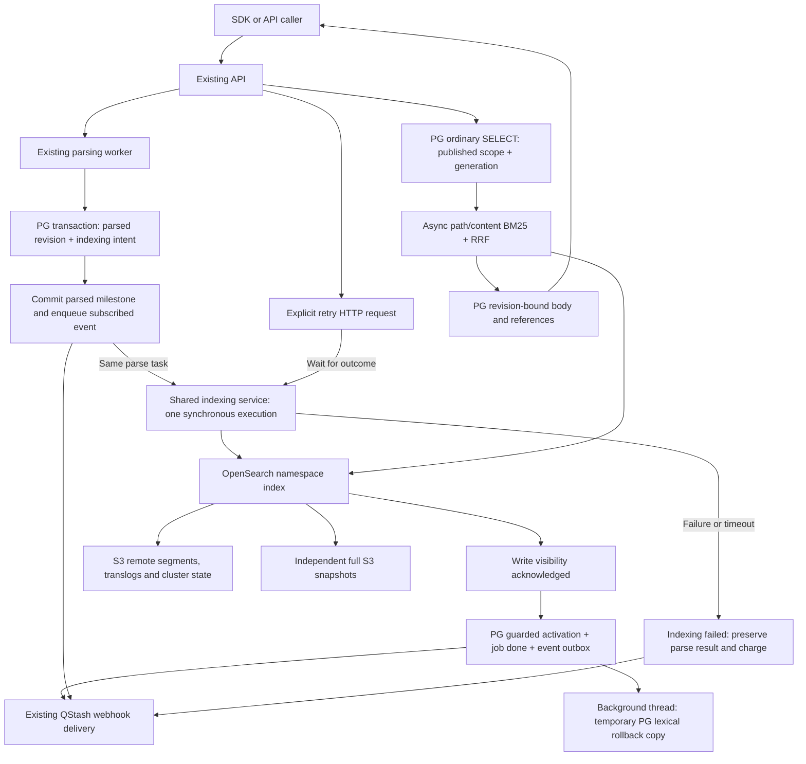

# OpenSearch lexical replacement: development and release plan

Date: 2026-11-05, America/Los_Angeles. Status: **ready for engineering review
and implementation handoff; not production acceptance**.

Latest owner amendment: initial indexing executes once in the existing parse
task; manual retry executes once synchronously inside its HTTP request. With
OpenSearch selected, both have a configurable ten-second whole-execution limit.
When PG is primary before cutover or after rollback, keep accepting documents
and require PG readiness, with a separately qualified longer execution budget.
While OpenSearch serves, its temporary PG copy uses a background thread and
does not gate completion. No new authoritative-indexing job/task,
automatic retry or detached continuation. Historical candidate queue/retry
results do not establish acceptance of this revised execution contract.

Owner-confirmed amendments (2026-11-05): write a revision in one
`refresh=wait_for` bulk when it fits the configured byte budget; split oversized
revisions by serialized request bytes. A client disconnect does not by itself
cancel an already-running manual-retry handler: it may finish its current
execution within the unchanged deadline. Cancellation of that handler or
process exit does not authorize another task or detached native work.

## Owner amendments after 2026-11-05

The owner made these decisions during staging integration and the first
production release. Each is implemented on `main` in the pull request named.
They take precedence over conflicting text in the sections listed.

| Topic | Decision | Supersedes or narrows |
| --- | --- | --- |
| PostgreSQL rollback terms | While OpenSearch serves, publication persists unit metadata but does not write PostgreSQL term rows. A deliberate rollback rebuilds terms for the current published revisions from the retained `indexing-input/v1` objects and verifies coverage before PostgreSQL serves. Staging and production set `KNOWHERE_OPENSEARCH_PG_COPY_ON_DEMAND=true`. ([#515](https://github.com/Ontos-AI/knowhere/pull/515)) | The continuously maintained background-thread copy in Sections 4, 9.1, 9.4, 11.1, 14.4 and 14.5 and in [ADR 0024](../adr/0024-keep-postgresql-lexical-index-for-migration-rollback-only.md). Rollback duration now includes this rebuild. |
| Agent outline scoring | When OpenSearch serves, `corpus.outline` and `corpus.node_filter` score long outlines with OpenSearch and do not read PostgreSQL term rows. Agentic retrieval is part of acceptance. ([#512](https://github.com/Ontos-AI/knowhere/pull/512)) | Section 6.4 acceptance scope. |
| Progressive publication | Progressive documents publish a searchable baseline first. Each refined section then republishes a whole-document build, and publication for one document is serialized. Sections that retrieval never triggers may keep their baseline indefinitely. Enabling or restoring a backend checks the current published coverage and blocks only on active progressive jobs, not on unfinished refinement. ([#510](https://github.com/Ontos-AI/knowhere/pull/510), [#511](https://github.com/Ontos-AI/knowhere/pull/511), [#521](https://github.com/Ontos-AI/knowhere/pull/521)) | The earlier rule that every progressive document must finish refinement before OpenSearch can be enabled or restored. |
| Retrieval that triggers refinement | Retrieval returns the published content immediately and schedules refinement in the background. The refinement claim is locked only when refinement is actually needed. ([#527](https://github.com/Ontos-AI/knowhere/pull/527), [#532](https://github.com/Ontos-AI/knowhere/pull/532)) | None. |
| One published version per query | [ADR 0023](../adr/0023-keep-progressive-retrieval-on-one-published-version.md) governs version selection, retained chunks, retired-build cleanup and the published build list. Both manifest settings default to disabled. ([#545](https://github.com/Ontos-AI/knowhere/pull/545)) | Sections 6.1 and 6.2 where they conflict. |
| Shared node and backups | Staging and production share the existing OpenSearch EC2 node with separate index prefixes, TLS identities, roles and client security groups. Staging keeps only on-demand snapshot and restore exercises. | Already reflected in Sections 10.1 and 10.2. |
| Latency work | After the five-QPS staging replay measured a server-side P95 of 0.49–0.61 seconds, the owner stopped latency work outside the lexical refactor. Staging API keeps 0.25 vCPU and 15 PostgreSQL connections; production API tasks run 0.5 vCPU. ([#531](https://github.com/Ontos-AI/knowhere/pull/531)) | Section 7.3 tuning scope. |
| Production backfill | Backfill covers each document's current published revision only. It runs in throttled slices during low-traffic windows, pauses on Aurora, API or worker guardrails, and keeps PostgreSQL serving throughout. | Consistent with Section 14.1. |

Status on 2026-11-12: production serves lexical retrieval from PostgreSQL.
Production API and worker tasks carry OpenSearch TLS identities for the
`knowhere-prod-lexical-v1` prefix. The first production backfill slice paused
after 23 of 100 documents were written and verified. Staging serves from
OpenSearch with both manifest settings disabled.

Open owner decisions before production cutover:

1. Whether production cuts over with the manifest settings enabled. The
   retention and retained-chunk rules in ADR 0023 apply only when they are
   enabled.
2. Whether production snapshots, alerting and a host-recovery drill must be in
   place before cutover. Section 10.2 currently starts production snapshots
   when production indexes are ready.
3. The cutover gate scope and the measured restoration time `R` for the
   Section 14.3 abort calculation. The current release bridge returns 503 for
   the entire customer route.
4. Whether the Section 7.1 one-hour ten-times mixed-load campaign remains a
   launch gate. It has not run. The 50-QPS target was not attempted after a
   25-request burst against one 0.25-vCPU staging API task reached an
   8.3-second P95.

This plan covers formal integration of the validated lexical replacement into
Knowhere's API, existing Celery/gevent worker deployment, client SDKs and
operations. It consolidates accepted decisions and identifies remaining work;
it is not a request to repeat the PoC or a claim that the candidate code is a
finished release. Repository documentation is written in English.

| Reader need | Jump to |
| --- | --- |
| Decisions made after 2026-11-05 and open decisions | [Owner amendments](#owner-amendments-after-2026-11-05) |
| Background, decisions and reusable work | [Sections 1–4](#1-handoff-summary-and-source-of-truth) |
| Client and consistency contract | [Sections 5–6](#5-user-and-client-contract) |
| Performance and its acceptance gates | [Section 7](#7-performance-plan) |
| Retrieval quality | [Section 8](#8-retrieval-quality-plan) |
| Worker and infrastructure integration | [Sections 9–10](#9-worker-publication-and-failure-integration) |
| Future evolution and maintenance | [Section 11](#11-operations-evolution-and-maintainability) |
| Development tasks and verification | [Section 12](#12-development-tasks) |
| Launch, rollback and observation | [Section 14](#14-rollout-rollback-and-observation) |
| Remaining work and completion evidence | [Sections 15–17](#15-remaining-decisions-and-configuration-work) |

## 1. Handoff summary and source of truth

The two selected pre-integration component gaps are closed: the largest retained
real namespace and the final reader-free 400-slot protocol pass. Begin formal
integration, retaining the validated async and locking changes. Defer further
temporary-driver latency tuning to the actual deployed API/worker topology.
Production cutover requires the additional gates in this plan.

Start with these references, in this order:

1. This execution plan and the [integration constraints](opensearch-integration-constraints.md).
2. The accepted [v1 product decisions](opensearch-lexical-v1.md),
   [ADR 0024–0029](../adr/README.md), and the [domain glossary](../../GLOSSARY.md).
3. The current [implementation design](opensearch-engineering-v1.md) and
   [implementation/evidence ledger](opensearch-implementation-progress.md).
4. Individual validation reports linked below for their exact measured scope.

Earlier discussion documents contain superseded reader leases, close exclusion
and SQL admission gates. They are history, not instructions to restore those
mechanisms. Later accepted amendments take precedence. Candidate code must be
reviewed against the accepted contract; a test result does not authorize a
different product behavior.

### 1.1 Reusable code is not yet a reproducible release

At preparation time, the working branch is
`feat/wangbinqi/opensearch-publication-slice`, based on HEAD
`fc186b185137dcf25d9d5b073dac49f1c895cacb`. Much of the candidate implementation,
migrations and validation material is **modified or untracked in the working
tree**. Checking out that SHA or sharing the branch name alone does not deliver
the PoC. It is not a verified production revision.

Before implementation, freeze a reviewed source snapshot that includes
the relevant tracked changes and untracked files, its dependency lockfiles, test
fixtures/provenance and evidence hashes. Preserve unrelated work. Record the
resulting commit or authorized patch bundle in the handoff. Do not commit secrets,
private business fixtures or local `/tmp` directories. Do not regenerate the
implementation from this prose while discarding the validated code.

### 1.2 Execution scope

The developer completes implementation, contract/integration/regression testing,
quality and performance verification, documentation, migration/recovery tooling,
and deployment rehearsals. Testing and verification are part of every task's
completion criteria. The work below is grouped by what must be built and checked.
Existing cost and production-change approvals still apply.

Owner clarification: **formal integration and release acceptance take place in
staging**. Oracle is the existing isolated development/PoC environment for
bounded mechanism checks and early measurements. Production deployment and
post-release smoke/observation happen only after staging acceptance under the
release procedure; production is not this project's initial acceptance venue.
Record staging API/worker/PG/native versions, effective configuration and SDK
compatibility in KW-01. Production compatibility inventory belongs to release
prechecks where needed, not a demand to run acceptance on production.

Distinguish work not implemented from behavior not measured. Inline indexing,
synchronous HTTP retry, the whole-operation deadline and the revised duplicate-
delivery policy are implementation tasks with their own tests. Their absence is
not an additional product decision or a prerequisite to finish this plan.
Oracle can measure existing publication work and verify existing component
guards now; it cannot certify a deadline or delivery policy absent from that
source. Validate the final integrated behavior in staging after implementation.

## 2. Background and intended outcome

### 2.1 Why the current design is being replaced

Classic lexical retrieval currently reads a global PostgreSQL term-frequency
table, although each request searches only one owner's namespace. Publication
maintains its posting rows and indexes alongside normal application data.
The restored catalog contains about **13.28 million rows and 14.5 GiB including
five indexes**. This couples a small namespace's work to a much larger shared
posting structure.

Two supplied observations motivate the change:

| Existing observation | Meaning and limit |
| --- | --- |
| A 188-page, 1.66-MB PDF took 141 seconds overall; publication-to-commit took 48.6 seconds, including 43.2 seconds writing frequencies. | One observed task, not a universal parsing/indexing benchmark. |
| A 27.9-second retrieval spent 18.9 seconds fetching frequencies. | One observed request, not a production percentile. |

The goal is faster, independently scalable lexical publication/retrieval and a
maintainable search component. It is not principally a storage-saving exercise:
the supplied estimate for eventually dropping the old table is only about
$1.5/month. PostgreSQL itself is not inherently unscalable; partitioning or
other PG work could change its behavior. This project replaces this particular
global posting design with the selected namespace-scoped search architecture.

### 2.2 Success means more than a faster search call

- A client can use a durable parsing result before lexical indexing finishes.
- Default job completion still means the revision is searchable.
- Updates keep the previous published OpenSearch revision searchable until the
  new one is activated; returned content and references bind the hit revision.
- The selected business evidence remains available despite accepted ranking
  differences from PG and during version coexistence/retry/cleanup.
- Query growth and posting maintenance no longer require the global PG lexical
  table; search capacity and operations can be managed separately.
- Native durability and independent backups survive the selected failures
  without requiring permanent PG lexical data.
- The release can be stopped or deliberately rolled back within the accepted
  maintenance budget while preserving the new client contract.

### 2.3 Scope boundaries

Move lexical token storage/matching/BM25 to OpenSearch. Keep vectors, canonical
body/page content, document/revision state and references in their existing
PostgreSQL/application placement; existing result ZIP/asset storage stays as
designed. Do not copy raw vectors or asset binaries into the lexical index.
`corpus.grep` and other non-BM25 operations are not automatically migrated.

Use one self-managed node for v1, one primary per scoped namespace and zero
replicas. Do not introduce a new dedicated ECS indexing service, permanent
PG lexical fallback, automatic scale-out, published-only custom IDF, or a full
parsing/LLM throughput campaign. Such changes require a separate evidence-backed
decision. Existing worker deployment and webhook infrastructure are reused.

## 3. Current evidence and remaining release work

| Area | Evidence already available | Still required |
| --- | --- | --- |
| Underlying durability combination | Seven ARM64 OpenSearch 3.9.0 cases passed with S3 emulation: acknowledged tail changes survived loss of the only node/local data, and an independent full snapshot restored without live repositories. | Real AWS permissions, connectivity, encryption dependencies, production-size coverage and measured recovery. |
| Small business replay | The corrected relative gate passed the unchanged 20-query baseline and the separate 40-case filter replay with the current ranking profile. The baseline also passed locally with raw indexing input across eight publication stages. | Verify the same contract against the staging configuration. See [development validation](opensearch-development-validation.md) for the evidence and its limits. |
| Large namespace | 42,794 real frozen units from 644 documents; 2,206 separately identified derived units extend a functional check to 45,000 records. | Current production inventory and representative target-node capacity. |
| Candidate depth | On that full frozen scope, 100/1,000/all-match candidates preserve all ten successes of the offline PG scoring reference. Default adapter and 100-candidate projection match. | Keep the finite-window relevance gate on final integration and future ranking changes. |
| Final slot protocol | Eight turnover contracts passed, including actual 360→320 turnover and namespace 401 admission with 400 indexes open. | Populated-index mixed load and target heap/disk qualification. |
| Version and query safety | Reader-free paths passed targeted native/PG regressions; latest size/slot check totals 17 contracts, with lint/type checks. | Full service/SDK/deployment behavior and affected regressions after integration changes. |
| Performance | Executor, PG coordination, resource-isolation, HTTP occupancy and native-response investigations exist. Token fields are now omitted from search responses. | Accepted warm/cold/wait targets on real service isolation and the target node. They have not passed. |
| Deployment | An additive migration/contract candidate exists; backend still defaults to PG. | Reviewed deployable artifacts, real infrastructure/runbooks, migration/backfill, rollback and cutover rehearsal. |
| Temporary indexing input | The design specifies retention and reclamation; current `LexicalInputStorage` implements save/load. | Implement reference-aware reclamation and orphan handling in KW-06. Current maintenance schedules PG copies and build cleanup, not an explicit input-object collector. |
| Reproducible handoff | The working branch, retained Oracle inputs and historical reports exist; selected Oracle checks and fixture access were reverified on 2026-11-04. | KW-01 must consolidate the developer handoff materials and freeze the reviewed source, including required uncommitted files. This does not require another environment or a ZIP; Section 17 defines the remaining baseline work. |

Important limits:

- The large fixture comes from a retained `knowhere-prod-20260902.dump` restore,
  not a fresh production export. Its PG comparison invokes the existing scorer
  offline, not the production PG query or final public result assembly.
- Candidate truncation changes results: comparing 100 candidates with all
  matches, Top-10 membership is identical for 10/20 queries and order for 9/20.
  No marked PG evidence is lost in that sample; exhaustive-RRF equivalence is
  not promised.
- The full 401-index boundary uses empty indexes; retained-data behavior is
  checked separately. The 45,000-record extension is explicitly derived data.
- Oracle's small capped node and temporary driver do not qualify the selected
  32-GiB production baseline. A reported native `took` is not total request time
  or CPU time. Do not add percentiles from separate cohorts.

Evidence: [compatibility](../validation/opensearch-compatibility-2026-11-03.md),
[business replay](../validation/opensearch-business-ranking-2026-11-03.md),
[final size/slot preflight](../validation/opensearch-namespace-and-slot-preflight-2026-11-04.md),
[reader-free queries](../validation/opensearch-unlocked-reads-2026-11-04.md),
[native wait attribution](../validation/opensearch-native-wait-attribution-2026-11-04.md).

## 4. Architecture and data ownership



The diagram describes the OpenSearch-serving phase. Before cutover, or after
an explicit migration rollback, PG is the selected primary lexical backend.
That is a controlled global backend selection, not a per-request fallback.

Use one create/update-index service entry point for parsing completion and
explicit manual retry. It owns the selected backend's publication and the
optional PG-copy handoff; endpoint/parser callers do not coordinate two writers.
While OpenSearch is primary, only its publication gates completion and the
PG rollback copy runs in a background thread. When PG is primary, new documents
and updates are still accepted; their parsed results can be read first, but
search readiness waits for the PG index to commit. The selected primary write
remains inline/synchronous; the non-gating thread is the temporary shadow copy.

| Data / responsibility | Storage or component |
| --- | --- |
| Authentication, authorization, documents, immutable parsed revisions, phase/attempt state, published pointers and cache generation | PostgreSQL/application services. |
| Canonical content, page/asset/reference relationships and vectors | Existing storage and retention; unchanged by this project. |
| Pretokenized lexical payload, inverted index, BM25 and native index state | OpenSearch. |
| Current native durable state and historical recovery points | OpenSearch-owned remote repositories and independent full snapshots. |
| Legacy term-frequency rows during migration observation | Temporary, asynchronously maintained deliberate rollback copy. |
| Queue notification and webhook delivery | Existing Celery/Redis and QStash; durable application intent/outbox remains authoritative. |

Index identity includes **corpus kind + resolved owner + namespace**, not the
namespace string alone. Private and shared-demo scopes use `CorpusStorage` and
existing authorization. Callers never select native index names or build IDs.
Preserve runtime-permission/RLS tests; OpenSearch is not a second public authorization
system.

### 4.1 Search contract

- Reuse existing jieba-prepared terms. Native analysis is `whitespace`.
- Set BM25 `k1=1.5`, `b=0.75` when creating the index. Accept native Lucene IDF;
  do not implement PG's negative-IDF floor in v1.
- Search path and content separately with the current OR matching behavior.
  Fuse with zero-based rank `r`: `weight / (60 + r + 1)`, weights 1 and 2.
- Start with `max(100, discovery_limit)` candidates per channel and preserve
  deterministic score/document/order/unit tie-breaking. Changing that window
  requires quality evidence, not an assumption of equivalence.
- Stored token fields remain available in OpenSearch. Search requests exclude
  `pathTokens` and `contentTokens` from returned `_source`; retain all binding,
  ordering and hydration metadata. Do not disable stored source or remove terms
  from indexing. Source filtering reduces returned bytes but still requires
  source loading/parsing. [Official field retrieval](https://docs.opensearch.org/latest/search-plugins/searching-data/retrieve-specific-fields/)
- Native statistics include physically present staged/obsolete builds even
  when filters exclude them from eligible hits. Correct revision selection does
  not imply stable ranking during staging or cleanup.

## 5. User and client contract

### 5.1 Revision views

| Operation | Default selection |
| --- | --- |
| Document-content read | Latest successfully parsed revision, including pending/failed indexing. |
| Job-result read/download | That job's immutable parsed revision. |
| Retrieval | Currently published revision; omit documents with none. |
| Content/asset/reference returned by retrieval | The revision actually retrieved, automatically bound by API/SDK. |

Normal retrieval returns actual eligible hits, including ordinary empty results.
Do not add pending-document warnings, an updating HTTP status, a second retrieval
endpoint, or public build selectors. A document allowlist with no published
revision can legitimately return empty. A published document with a missing or
incompatible persisted build binding is a backend/correctness error, not an
unready-new-document case to silently omit. Confirmed missing native coverage
during cutover/recovery also blocks serving that affected scope. These checks
do not imply that every ordinary search audits all physical records.

Namespace-changing replacement is not an existing v1/v2 API feature. Both job
routes use `DocumentIngestionService` and
`apps/api/app/services/document_ingestion/scope_service.py`:
`resolve_effective_document_scope` rejects an explicitly different namespace
for an existing `document_id`; omission retains that document's namespace.
Demo/private scope boundaries remain enforced. Preserve this behavior during
both backend selections and deliberate rollback. Earlier engineering wording
about atomically moving two namespaces is a condition for a future separately
approved feature, not an instruction to implement namespace moves here.

### 5.2 Phase states and historical completion

Keep existing overall job statuses. Add/project these revision-scoped fields:
`parsing_status` = `pending|running|completed|failed`;
`indexing_status` = `not_started|pending|running|completed|failed`;
`failure_stage` = `null|parsing|indexing`.

Owner-confirmed definitions: use qualified completion terms throughout service,
SDK and operations code. These meanings are decided, not pending alternatives:

| Meaning | Authoritative condition | What it does not imply |
| --- | --- | --- |
| Parsing completion | `parsing_status=completed`; this revision's durable parsing result is readable. | Indexing or overall job success. |
| Indexing completion | `indexing_status=completed`; the selected primary backend's writes, visibility and guarded publication have committed for this revision. | Completion of the non-gating PG shadow copy or permanent future service availability. |
| Overall job success | `status=done`, with both phases completed. `job.completed` describes this milestone. | Merely returning an early parsing result. |
| Job termination | `status` is `done` or `failed`; the current execution is no longer active. | Success: a failed job is terminal too, until an eligible explicit retry is admitted. |
| Client wait satisfaction | That invocation's selected milestone is satisfied: parsed or search-ready. | A different persisted job status or permission to stop server processing. |
| Celery task completion | The worker invocation has returned after handling its work. | Search readiness: an indexing failure is recorded before the parse task returns normally. |

There is one authoritative job/phase state for all callers. Do not add a shared
unqualified `complete` flag or change API `status`, overall `isDone`/`isFailed`,
admission, or sweep behavior according to event subscriptions or SDK wait mode.
Celery task state is execution bookkeeping, not this job's completion contract.
The initial parse task still contains both sequential phases; separating their
milestones does not create two tasks. Preserve the wire compatibility distinction:
job responses use `status=done`, while `job.completed` webhook snapshots use
the existing `status=completed`. Both mean overall success, never parsing alone.

These are phases of the same document-processing job. "Indexing in progress"
means parsing has completed and retrieval publication is pending/running; it
does not mean the parser is still running or that a separate job was created.
Indexing failure preserves `parsing_status=completed` and the parsing result
while setting `indexing_status=failed`, `failure_stage=indexing` and overall
`status=failed`.

| Situation | Overall status | Parsing | Indexing |
| --- | --- | --- | --- |
| Upload/parse admission | Existing `waiting-file` / `pending` | pending | not_started |
| Parsing/conversion | Existing `running` / `converting` | running | not_started |
| Parse durable, inline indexing not yet started | running | completed | pending |
| Indexing executing | running | completed | running |
| Eligible explicit indexing retry admitted | pending | completed | pending |
| Visible, activated and committed | done | completed | completed |
| Parsing failure | failed | failed | not_started |
| Final indexing failure | failed | completed | failed |
| Archival commits before indexing activation | failed | completed | failed |
| Planned backend transition interrupts unfinished indexing | failed | completed | failed |

`done` is irreversible. Later closure, node outage, archival or replacement does
not turn a completed job into failed. Indexing failure ends the current attempt;
an eligible explicit retry may start another attempt on the same job. Late
events/tasks from old attempts cannot overwrite a newer outcome.

After parsing completes, archival is allowed immediately while indexing is
pending or running; subsequent retrieval excludes the document without waiting
for physical cleanup. Coordinate archival and activation atomically: if archival
commits first, terminate the unfinished job with `failure_stage=indexing`,
parsing `completed`, indexing/overall `failed` and an archival explanation.
Retain its parsing result and charge, emit subscribed `job.failed`, stop
unfinished indexing and reject explicit indexing retries for the archived
document. Delayed workers cannot publish it. If activation/completion commits
first, later archival retains historical `done` and completed phase states.
No cancellation state or event is added. These are the existing contracts in
[ADR 0026](../adr/0026-publish-search-readiness-from-background-tasks.md) and
[ADR 0027](../adr/0027-activate-document-revisions-only-after-search-readiness.md).

The owner also permits planned backend switching to interrupt unfinished
indexing. Preserve the parse and charge, record indexing-stage failure, and
require an eligible explicit retry after service resumes. A backend switch
does not automatically resume that attempt or regress historical completion.
See the [in-flight transition rules](#1431-in-flight-jobs-during-a-backend-transition).

Review the draft migration's projections for legacy jobs. Preserve historical
results, charges and terminal status. A backfill labeling an old combined-flow
failure as parsing failure is a compatibility projection, not proof of its
historical root cause; document that interpretation and test mixed old/new rows.

### 5.3 SDK behavior

Implement the accepted options on both `parse()` and `jobs.wait()`:

| SDK | Option | Values |
| --- | --- | --- |
| Python, sync and async | `wait_for` | `"search_ready"` default; `"parsed"` opt-in. |
| Node | `waitFor` | `"search_ready"` default; `"parsed"` opt-in. |

The option affects only that invocation's wait, not background work, charging
or webhook subscriptions. Parsing-only wait succeeds when parsing is complete,
even if indexing has already failed before the first poll. Result loading must
then accept the retained parsing result without requiring overall `done`.

| Observed job state | Parsed-only caller | Default search-ready caller |
| --- | --- | --- |
| Parsing in progress | Keep waiting. | Keep waiting. |
| Parsing completed, indexing pending/running | Return the usable parse; the job remains active. | Keep waiting. |
| Parsing completed, indexing failed | Return the usable parse; the job's actual overall status remains failed. | Raise the indexing-stage job failure with retained-result context. |
| Both phases completed, overall done | Return success. | Return success. |
| Parsing failed | Raise the parsing-stage job failure. | Raise the parsing-stage job failure. |

A caller may present its own parsing workflow as complete after `job.parsed`
or a successful parsed-only wait. Label that as parsing completion in Knowhere
documentation/examples; never manufacture an early `job.completed` event,
`status=done` response or `isDone=true` helper. Returning from a successful
parsed-only wait and reporting the actual job as running/failed are compatible:
they answer different questions. Event selection controls callbacks; SDK
`wait_for`/`waitFor` controls when that invocation returns. Subscribing only to
`job.parsed` does not automatically select parsed-only SDK waiting. Without an
explicit wait target, the SDK waits for both phases; with a webhook URL but no
event selector, callbacks remain `job.completed`/`job.failed`.

Node's current `resources/jobs.ts` has an explicit `isDone` load guard; update
it. Audit Python's object/ID/URL loading paths and both polling implementations.

Default wait raises the existing job-failure exception on final indexing failure,
with the stage, original job ID and accessible retained job/result context.
Callers must not re-upload or manually coordinate revision maps to retrieve the
successful parse. Use language-native field naming consistently.

Preserve the configurable 30-minute default polling timeout as one budget per
wait invocation; do not restart it after parsing. Timeout reports the original
job/latest known state and leaves server work running. Resuming wait or issuing
an eligible indexing retry uses the same job. Preserve default behavior against
legacy responses with missing phase fields; do not claim early parsed readiness
on an older server that exposes only terminal completion.

The same server execution and phase states apply to both waiting targets.
After parsing commits, dispatch subscribed `job.parsed` without waiting for
indexing or webhook delivery, then run indexing once in the existing parse
task. On indexing failure, a search-ready wait raises; a parsed-only wait
still succeeds, including when its first observation is already overall
`failed`. Persist `parsing_status=completed`, `indexing_status=failed`,
`failure_stage=indexing` and emit subscribed `job.failed` in either mode.
Return normally from the Celery task after recording that indexing outcome;
do not use the parser's exception/autoretry/refund hooks for indexing failure.
Celery task success means its processing finished, not that the job is ready
for search. No server-side wait-mode flag or new failure event name is needed.

Preserve the configurable polling interval as well. Polling adds that interval
to observation time; clients needing a prompt parse milestone can subscribe to
`job.parsed`. Neither polling nor webhook delivery is an instantaneous-delivery
or fixed thirty-second indexing promise.

### 5.4 Free indexing-only retry and admission

Candidate routes already exist at
`POST /v1/jobs/{job_id}/indexing/retry` and the v2 equivalent. No request body;
normal job ownership and write permission are required.

| Case | Required response / behavior |
| --- | --- |
| Eligible final indexing failure | Run one execution synchronously in this request; 200 on published success, canonical non-2xx on failure with retained-result context. Same job/revision, no parsing or new charge. |
| Retry already active | 409 with `INDEXING_ALREADY_RUNNING`; no duplicate execution. |
| Job historically done | 200 with existing state; no rebuild. |
| Later update accepted for the document | 409, `details.reason=INDEXING_SUPERSEDED`; do not revive the old candidate even if its successor fails. |
| Another active document job | 409, `DOCUMENT_JOB_ACTIVE`, with authorized active-job context. |
| Archived document or parse incomplete | Existing precondition error; no reactivation. |
| Required canonical parsing result lawfully removed under its existing lifecycle | Explicit precondition failure; no silent reparse or charge. A renewable URL expiring is not result removal. Unexpected missing/corrupt assigned indexing input is an operational error, not an elapsed retry window. |
| Inaccessible/missing job | Existing authorization/not-found behavior; no tenant disclosure. |

Retain one active job per document through both phases and an admitted manual retry.
Other documents in that namespace can proceed concurrently. Competing explicit
retry requests use the same current-attempt guard; an already-active execution
returns 409 rather than making another request wait or run it again. No new
public idempotency protocol is needed.

Owner-confirmed replacement rule: a new-version upload returns 409 while the
document's existing job has any nonterminal overall status, even if its
indexing deadline has elapsed. The upload/admission path does not settle the
old job, start a retry or create a replacement job as a side effect. It waits
for a committed `done`/`failed` outcome before admitting a new version under
the normal scope/permission rules. Redelivery, sweep and explicit indexing
retry retain their own guarded settlement behavior. This deliberate asymmetry
keeps new-version admission simple; only the retry endpoint offers immediate
expired-indexing recovery.

Owner-confirmed example: revision A parsed successfully but failed indexing.
Once a new job for revision B is durably accepted, an indexing retry of A
returns 409 even while B is only parsing. Do not run, queue or defer A's retry
until B finishes, and do not treat parsing completion as releasing B's active
job. B's later failure does not restore A's eligibility. If A's eligible retry
wins concurrent admission first, reject B's new-job request while that retry
is active. Both operations obey one document-level admission rule; a retry
still uses A's original job/revision and creates no new job.

After successful parsing, indexing failure **never refunds the parse charge**,
regardless of waiting mode. Existing parsing-failure refund behavior remains.
There are no automatic indexing retries and no separate age-based retry expiry.
An otherwise eligible failed candidate remains retryable while its document is
active, it has not been superseded, and its canonical parsing result remains
available. Retain the temporary indexing input for that eligibility, even for
an old failure. Existing authorization, active-job admission, canonical-result
lifecycle and rate limits still apply; elapsed age alone cannot revoke retry.
[Billing decision](../adr/0029-keep-parsing-charges-and-allow-free-indexing-retries.md)

The manual retry endpoint executes synchronously in the HTTP request. It does
not create a job, dispatch a Celery task, or continue indexing in a detached
background coroutine. Reuse the original job/revision and the same indexing
service as the parse task. Return 200 with the normal job response only when
already done or newly published. An active execution returns 409 /
`ABORTED` / `INDEXING_ALREADY_RUNNING`, without starting another one.

For an admitted execution that fails, first persist its indexing failure and
subscribed failure event, then return the canonical error with original job ID,
phase states and accessible retained-result context: 504 / `DEADLINE_EXCEEDED`
for execution timeout, 503 / `UNAVAILABLE` for unavailable native service, and
500 / `INTERNAL_ERROR` for corrupt internal input/mapping. The SDK method waits
for this response and exposes the same result/error context; it does not poll
an implicitly queued retry. A lost HTTP response is not proof of rollback:
check committed state before a later explicit retry. Concurrent calls must
respect the active-attempt conflict without admitting duplicate executions.

Owner-confirmed disconnect rule: losing the client's HTTP connection alone is
not a cancellation request. If the original server request handler is still
running, continue only its current indexing execution until success/failure or
the already recorded backend-specific deadline. Do not actively cancel it just
because the socket closed, reset its budget, or transfer it to a new coroutine,
thread, queue task or another worker. This is the original bounded request
execution, not a detached continuation. The client can query the original job;
normal subscribed milestones still record the actual outcome.

If the server handler itself is cancelled, the process exits, or the operation
deadline expires, stop its forward indexing work. Preserve committed success;
otherwise attempt bounded failure settlement where possible and let the existing
guarded recovery/sweep repair abandoned state. Do not suppress cancellation to
continue native writes or activation in detached work. Already-sent native
requests may still finish remotely, so retain uncertainty and late-writer
fencing. A response-send failure after commit cannot change `done` to failed.
The SDK polling-wait timeout is a separate observation limit and still does
not cancel the parse task's server work.
Disable automatic HTTP retries for the indexing-retry mutation in both SDKs;
one explicit invocation must not silently create another attempt after a
failed/lost response. Preserve unrelated polling and retrieval retry policies.
Use nonblocking API I/O while awaiting the result; synchronous HTTP semantics
do not authorize blocking the API event loop with the worker's sync client.

An active-state label alone is insufficient to reject manual recovery. Under
the normal guards, inspect the current execution's stored deadline and actual
committed outcome first. If genuinely active and unexpired, return 409. If
expired, preserve any committed completion; otherwise settle its indexing
failure and admit the one new execution explicitly requested by this call,
subject to eligibility and native-uncertainty fencing. Do not make callers wait
for the periodic sweep merely because an expired row still says running.
This request is explicit recovery, not permission for automatic re-execution.
A pending initial intent with no execution start uses its own creation time
and the configured interruption threshold. A manually admitted attempt uses
this retry request's persisted operation deadline, even before an execution
claim; never time it from the original parsing completion. See Section 9.3.

### 5.5 Webhooks

Use one `webhook.url` with optional nonempty exact `events`:
`job.parsed`, `job.completed`, `job.failed`. Omission keeps existing terminal
notifications. Normalize duplicates; reject empty, unknown, wrong-case or
wrong-type event values and invalid URLs before charging/admission.
Omission differs from explicit JSON `null`; SDK serialization must omit an
unset event selector rather than turn its default into an invalid null value.

- `job.parsed`: immutable parsed result is durable/readable, overall job may
  still be running. An indexing retry does not emit another parsed event.
- `job.completed`: indexing visibility and guarded publication have committed.
  Preserve legacy webhook `status="completed"`; job GET uses `status="done"`.
- `job.failed`: include `failure_stage`, both phase states and the standard error;
  indexing-stage failure retains access to the successful parsing result.

Create logical events atomically with their state milestones. Preserve existing
signing/delivery and project `event_id`, immutable revision and original milestone
time (`parsed_at`, `completed_at`, `failed_at`). Re-delivery reuses the event and
its event-time state; only expiring access credentials may renew for the same
revision. A new explicit attempt can emit a distinct failure event.

After commit, make a bounded attempt to notify the existing delivery mechanism;
successful QStash submission or customer delivery is not a prerequisite for
indexing or the HTTP outcome. If submission fails or times out, keep the durable
outbox event for existing notification recovery and continue the committed
workflow. A notification failure cannot fail/refund the parse, restart indexing
or regress a completed job. Bound dispatch overhead separately and ensure it
cannot indefinitely hold the parsed-to-indexing handoff. Test this boundary
with a blocked/unavailable fake delivery provider, not only reordered callbacks.

There is no delivery-order guarantee and no public state-version counter.
Timestamp/event ID gives history; job GET remains authoritative. Do not build
a cross-event delivery sequencer or let a late failure mutate a completed job.
Exercise real local delivery/signature boundaries with a fake provider before
separately authorized paid-provider acceptance.

## 6. Query consistency, locks and lifecycle: rules to preserve

### 6.1 Normal hot retrieval

1. Resolve authorization and capture backend/epoch, namespace generation,
   native index identity and eligible document/revision/build bindings in one
   ordinary PG SELECT. An empty scope preserves its generation without writes.
2. Use that capture for cache keys, build/unit filters, hit validation and
   canonical hydration. Reuse the API's existing async SQLAlchemy engine/pool.
3. Return the database connection before waiting for native HTTP. Await the two
   channels with the loop/endpoint-scoped async client and shared query builder.
4. Validate returned identities and hydrate body/assets/references from the hit
   revision. Close handles without new reader coordination transactions.

Normal reads do not register/renew/release reader or native-use leases, mutate
recency rows, acquire shared control/generation/registry row locks, initialize
registry rows, or call hot-path lifecycle/UUID preflights. Do not wrap the whole
API request in `to_thread`, create per-query executors or introduce a sync PG
pool into this path. Mutation-side locks remain necessary; ordinary MVCC/internal
database locking and connection limits still exist.

The measured final path uses five ordinary SQL statements per normal read,
including non-capture reads, versus 19 earlier. One statement describes scope
capture, not the complete API. Explicit coordination locking SELECTs fell from
eight to zero. Preserve the observable behavior, not a brittle SQL-string count
if a justified integration change alters statement layout.

Distinguish metadata validity, native query outcome and corpus integrity. Scope
capture validates the persisted publication/build/index bindings; native calls
must surface missing-index, timeout, partial-shard and invalid-hit errors.
A successful query with no matches is ordinary empty evidence, not proof of
corruption or proof that all published records still exist. Do not add a native
count/existence probe per document or build to this hot path. Required coverage
is checked at publication and explicitly during migration/recovery; a silent
out-of-band loss of records cannot be reliably diagnosed from that query's
hit count alone. Known coverage gaps remain unavailable until resolved, while
an old captured build removed by permitted cleanup follows Section 6.2.

### 6.2 Replacement, cache and cleanup

Keep the old published build selected until a new visible build is atomically
activated. If cleanup deletes an old build before an already captured search,
return its actual remaining hits or empty result without a version retry. If
hits already exist, their body/reference revision remains fixed. Do not silently
substitute the document's current revision.

Cache keys use the captured backend epoch/generation. A late old response must
not populate the new generation's key. Physical staging can change native BM25
statistics; publication identity is the consistency guarantee, not frozen ranks.

Cleanup targets exact non-reusable build IDs, refuses the current build and
does not wait for readers. Retain tombstones and repeat bounded sweeps for late
writes/conflicts. An empty delete pass does not prove an old writer is finished.
Stale/superseded/archived workers cannot activate. Canonical body, asset and
reference retention is unchanged.

Owner decision: **v1 closes and retains empty namespace indexes**. Continue
normal exact-build cleanup for eligible archived, obsolete and failed records;
retaining the index is not a reason to retain unnecessary records. After
eligible cleanup confirms an empty index, close it through the existing
maintenance/lifecycle protocol and keep its registry/native identity. A later
upload reopens that same index through ordinary admission rather than deleting
and recreating it.

An empty published scope alone does not prove the native index is empty:
candidate builds, unresolved writers or retained records may still exist.
Preserve their eligibility/fencing rules; this does not add a reader/use close
fence or change ordinary LRU semantics. Whole namespace-index deletion and
recreation are outside v1. Monitor retained empty/closed catalog counts and
metadata/disk growth; any later whole-index retention/deletion feature needs
its own design, including identity, concurrent publication and backup handling.

### 6.3 LRU and cold recovery

- Retain the 400 business-slot cap, counting open/opening/closing/uncertain
  reservations and unmanaged business indexes. Budget system indexes separately.
- Start with high/low watermarks 360/320; current periodic turnover is every
  30 seconds. Validate watermarks on populated target-node workloads.
- Recency hints are best-effort, process-local, bounded to 4,096 indexes and
  flushed every ten seconds through the API async pool. Lost hints affect
  eviction efficiency, not revision correctness.
- Only lifecycle mutations serialize create/open/close/reservations. LRU can
  close during native reads/writes; reader/use leases are not close fences.
- A recognized closed-index search error allows one recovery and replay of
  the original captured scope. Settle both channels and preserve unknown errors.
  A second close, missing index, timeout, invalid or partial native response is
  unavailable, never empty success or PG fallback.
- A closed-index write failure terminates that indexing execution without
  automatic replay. Only an explicit manual retry may start another execution.
  Unknown late writers retain cleanup/fencing records.
- A lifecycle timeout/lost acknowledgment does not release a slot or authorize
  an opposite operation. Reconcile uncertainty; do not auto-recreate a known
  missing index or clear reservations because a lease elapsed.
- `uncertain` blocks new/conflicting lifecycle operations and new writer
  admission through that lifecycle path. It does not add a lifecycle-state
  read gate to ordinary captured-scope hot search or an otherwise valid cache
  hit. A recognized closed-index failure must use the guarded recovery path,
  which refuses to reopen/replay while uncertainty is unresolved. Keep normal
  unavailable-error handling and all existing writer claim/identity checks;
  this distinction does not weaken mutation fencing.

### 6.4 Agent retrieval and native failure propagation

Owner decision: an unrecovered OpenSearch service failure during an agent
retrieval fails the whole retrieval request as temporarily unavailable. This
includes timeout/disconnection and failure after the one permitted closed-index
recovery. Do not let the model continue through `corpus.read`, `corpus.grep`,
another recall or an alternate harness to turn that failed request into a
successful answer. Ordinary zero matches and correctable tool-argument errors
remain normal inputs to continued exploration. No PG lexical fallback is added.

Preserve typed fatal failure across the tool registry, dispatch wrapper and
both `openai` and `cursor_sdk` harnesses, including callback/thread boundaries.
The current `agent_tools/registry.py`, `agent_explore/dispatch.py` and Cursor
callback each catch broad exceptions and convert them into ordinary tool errors;
the outer retrieval plan cannot map an exception it no longer receives.
Changing only the native adapter's exception is therefore insufficient. A
request-wide fatal outcome must survive those wrappers and be checked before
successful response assembly/cache writes, even if a harness attempts to finish.
Retain existing fatal identity/authorization checks as well.

Stop further agent tool/LLM work, settle/cancel outstanding calls within normal
request bounds, and record the failed retrieval with safe diagnostic context.
Previously gathered evidence is not a successful final response and must not be
written into the normal result cache. JSON v1/v2 return the canonical 503 /
`UNAVAILABLE`. A cache hit or small-corpus path that never attempts a failing
native operation can still follow its existing contract; do not add a health
probe to those routes. Existing client retry policy is a separate concern.

KW-01 must identify the actually supported transports. The inspected v1/v2
routes expose JSON; accepted [ADR 0005](../adr/0005-stream-retrieval-progress-over-sse.md)
describes SSE but does not establish a
shipped streaming route in this candidate. If the deployment baseline includes
a supported stream, apply the same fatal outcome: once HTTP headers are sent,
emit its existing terminal failure envelope rather than claiming to change the
HTTP status, and never emit a successful final result or `no_results`. This
migration does not add a streaming endpoint merely because an earlier ADR exists.

## 7. Performance plan

### 7.1 Accepted targets

All are internal release-validation targets, not customer SLAs or established
results. The observed production arrival peak was five requests per rolling
second; the selected profile preserves its rhythm and scales volume ten times.

| Gate | Required result |
| --- | --- |
| Warm namespace lexical discovery | P95 ≤1 second under the selected mixed load, including published-scope lookup, required PG/native round trips, both channels and RRF/candidate delivery. |
| Cold first discovery with capacity available | Victim close if needed + target open + first lexical discovery P95 ≤3 seconds. |
| Capacity-wait budget | Five seconds, shortened by an earlier caller deadline; expiry returns retryable 503 busy. |
| Successful first discovery after capacity waiting | P95 ≤8 seconds measured from starting that wait through first lexical discovery. |
| Normal target load | No capacity-caused timeout/busy rejection or final indexing failure. Deliberate saturation is a separate test. |
| Indexing recovery | At a burst boundary, all eligible unfinished work admitted by then, including running work, reaches committed search readiness within five minutes while ten-times ordinary arrivals continue. No persistent backlog growth across bursts. |
| Duration | One measured hour of the ten-times real peak/trough profile, then five minutes of ten-times ordinary arrivals; setup/warmup excluded. |

This is **50 peak external retrieval QPS**, not continuous 50 QPS and not 50
OpenSearch HTTP calls per second. Record actual path/content/agent fan-out.
Full parsing throughput, simulated parser occupancy and external agent/LLM
capacity are outside this component qualification.

### 7.2 Workload and measurement

- Before measurement, KW-09 must deliver the versioned, checksummed private
  workload manifest defined below. The historical
  `retrieval-qps-2026-11-01/request-timing.csv` records read timing, route and
  status only; it is not a complete mixed-load input. Post-parse write-arrival
  data and a complete runnable campaign remain to be prepared and verified.
- Freeze the read-arrival trace and post-parse indexing unit/byte arrivals;
  include a hot namespace, realistic namespace distribution, the largest
  prepared namespace, small namespaces, updates, retries and maintenance.
- Feed retained non-LLM parser outputs through the actual completion/handoff
  boundary, Celery tasks, native visibility and PG activation. Do not parse PDFs
  repeatedly to manufacture indexing load.
- Use the deployed staging API/worker/PG isolation and target durability settings.
  Record every revision, configuration, pool, CPU/memory limit and network path.
  The producer must record offered arrivals independently of API scheduling.
- Separate warm, cold and capacity-wait cohorts; cache/small-corpus bypasses,
  actual lexical executions, failed requests and SDK retries must be visible.
  Do not warm every namespace and call that cold/LRU acceptance.
- Record full request and lexical timings; PG pool/transaction/lock intervals;
  native HTTP pool wait, connection lifetime/bytes and response processing;
  native task/queue counters and CPU/heap/GC/disk; parse-task backlog, inline/manual
  indexing duration, bulk, visibility and activation age. Validate error rates and correctness as well
  as successful percentiles. Ten-second indexing timeouts remain failures in
  normal-load denominators; draining the backlog by failing jobs is not catch-up.
  Measure representative largest-document and synchronous manual-retry paths,
  including preparation and all visibility waits, before claiming the limit is viable.
- Include a completed, coverage-verified full snapshot overlapping normal
  indexing/LRU during the qualification campaign. Backup/cleanup work is part
  of normal operation; do not move it outside the measurement to hide contention.

Define clock origins in the report: indexing age starts at the durable parsed
handoff/indexing intent and copy age at its publication/copy intent. Snapshot
completion age starts at verified successful completion; its recoverable data
boundary and duration are recorded separately under Section 10.2. Freeze the catch-up cohort at the
burst boundary; report later arrivals and any archival/supersession exclusions
separately rather than dropping slow or failed jobs from the denominator.

Use lightweight sampling for qualification; expensive profiling/packet capture
belongs in a bounded diagnostic run. Use monotonic clocks for local intervals
and trace IDs for correlation. Do not use rejected Query Insights absolute-time
subtractions, `took` as CPU time, or sums of independent P95 values.

#### Workload manifest gate

Freeze the following before the measured campaign. Its exact input paths,
hashes, transformation program/version, random seed, configurations and output
paths belong in the private handoff package, not in public business fixtures.
Unfilled fields block the campaign; recording them after seeing results does
not qualify a run.

| Manifest content | Required definition |
| --- | --- |
| Source intervals and provenance | Exact UTC read/write observation intervals, source file identities/hashes, field definitions, missing fields and any reviewed derived inputs. A read-only timing CSV cannot establish indexing volume or bytes. |
| One-hour time mapping and 10× rule | Executable mapping from source offsets to the measured hour and subsequent five minutes; any repetition, translation, inter-request offsets and deterministic multiplicity. Preserve real burst/trough structure and the accepted 50 peak requests per rolling second, rather than flattening to continuous 50 QPS. Specify burst start/end offsets and catch-up boundaries before running. |
| Read inventory | Expected offered request totals, route/query/options/namespace schedule, hot/cold/large/small namespace distribution, cache state, small-corpus shortcuts and agent fan-out policy. Report offered, started, completed and actual lexical/channel execution counts separately. No paid agent/LLM work is admitted. |
| Post-parse write inventory | Exact arrival times, source revision/prepared-input hashes, document/unit counts, uncompressed/compressed input bytes and native bulk-byte/count distributions; update/retry/supersession cases. Identify observed versus derived ten-times arrivals and separately throttled migration work. |
| Cohorts and sample sufficiency | Assign every measured request to a predeclared warm/cold/capacity-wait cohort with exact planned counts and numeric minimum completed samples per percentile. State preconditioning, expected slot state and what happens if the minimum is not met. These counts/minima are still to be specified in KW-09; insufficient or empty cohorts are unqualified, not passing. |
| Error and backlog denominators | Preserve all offered requests/jobs, timeouts, rejections, failures, producer lag, retries, duplicates and exclusions. Separate deliberate saturation/fault injection from normal-load gates. Define eligible catch-up job IDs at each burst boundary and record every excluded job with its reason. |
| Reproduction and assertions | Runner command/version, target revisions/isolation/pools, warmup, one measured hour and five-minute catch-up, overlapping snapshot/maintenance schedule, output schema and pass/fail rules for Section 7.1. The producer must not silently reduce arrivals when the service slows. |

Compare the generated schedule and expected counts with the manifest before
execution. Retain raw timestamps and scheduled-versus-offered differences.
Missing production write inputs require an explicitly identified, reviewed
prepared-data derivation; do not present synthetic write distribution as measured
production behavior or choose a lighter profile after a failed run. This is a
reproducibility requirement, not a new customer latency or recovery promise.

### 7.3 Tuning after real integration

Tune only against measured bottlenecks: resource allocation, index execution
concurrency, gevent/prefetch, bulk count/bytes, pool limits, compression and LRU
watermarks. Preserve the accepted safety contract. Do not enlarge HTTP/PG pools
to hide a slow downstream service or reintroduce row gates for convenience.

The prior 0.55-CPU experiments showed that both caller scheduling and native
CPU/network response work can stretch wall time. A 32-connection pool can queue
because connections await native responses. Search-task CPU of a few
milliseconds does not establish a one-second production request. Response
projection is already implemented; disabling compression was only a diagnostic
control, not a selected production policy.
The last multi-second diagnostic timings predate response projection; later
projection/size checks were functional. No post-projection 50-QPS latency
improvement or remaining-latency figure has been established.

No global production indexing cap of two has been accepted. Two executions and
the 12+12 test PG pool were harness settings. Reuse the existing worker service,
choose production concurrency/prefetch/bulk limits from the accepted workload,
and document the results. Existing async HTTP 32/20 connection settings are a
starting point, not a throughput guarantee. Backfill remains separately limited.

## 8. Retrieval quality plan

The owner confirmed that retrieval quality is a migration regression check.
Compare useful evidence against PG on the same corpus, permissions and query
options. Keep the current OpenSearch ranking profile and record isolated rank
or membership differences. Investigate material loss of useful evidence across
the reviewed queries or within a recognizable query class. Exact rank or
membership parity is outside the migration scope. Permission, revision,
content, asset and citation identity remain independent acceptance gates.

1. Freeze comparable corpus revisions, query text/options, permissions,
   expected evidence groups and target final result count before comparison.
   Retain business review provenance and negative cases.
2. Keep the 20 logged-query set as a regression baseline. Extend with genuine
   representative common/rare/multiple terms, path matches, namespace sizes,
   filters, exclusions, shared-demo permissions and relevant languages. The
   existing twenty formulations cover only four intent families.
3. On final public retrieval, preserve marked evidence that PG finds on the
   same inputs in the frozen regression suite. For exploratory cases, record
   evidence differences and investigate material quality regressions. Track
   shared misses separately. Verify source text, citation and asset identity,
   permissions and revision.
4. Exercise partial/complete unactivated builds, failed/retried candidates,
   activation, cleanup and deleted-record statistics. Do not force-merge only
   the acceptance fixture or exclude difficult cases after seeing results.
5. Compare candidate depths independently, keeping final Top K fixed and
   including downstream hydration/ranking/filter behavior. Default 100 passed
   the sampled component evidence gate, not an exhaustive equivalence proof.
6. Record ranking/query/tokenizer/mapping versions and evidence for any material
   change. Do not deploy a new dictionary, scoring script, channel weight,
   candidate window or shard layout without affected quality/performance checks.

OpenSearch matching/ranking remains controllable through the adapter's query,
field/filter definitions, BM25 configuration and application RRF/ranking.
Restoring PG's exact negative-IDF formula would require the separately explored
custom scoring/statistics path and its own cost/latency review. It is not part
of v1 and is not needed merely to make ranks look identical.

### 8.1 Align the regression test with the accepted quality gate

The [historical business replay](../validation/opensearch-business-ranking-2026-11-03.md)
failed its final absolute-evidence assertion on seven shared misses. The current
harness evaluates PG and OpenSearch together and retains separate baseline and
extended suite identities. The [development validation](opensearch-development-validation.md)
records the completed replays, including the earlier failure.

For each staging replay:

- At each query/stage/evidence-group boundary, use the appropriate old/new
  corpus baseline and frozen result count. Every marked evidence group found
  by PG must also be present in the OpenSearch result. One lost PG-found group
  fails even if another group for that query is present.
- Report PG-only, OpenSearch-only, shared successes and shared misses with
  ranks and evidence identity. Shared misses remain visible quality gaps and
  do not alone fail the relative replacement gate. Identity, permission,
  version, body, asset and citation failures independently block acceptance,
  including cases where PG also fails.
- Keep the evaluator's controlled PG-hit/OpenSearch-miss, shared-miss and
  identity-failure tests. Retain frozen labels and record any manifest or
  provenance change separately.
- Run the original immutable 20-query baseline and the separately versioned
  extended suite. Retain both reports and summarize their quality gates.

## 9. Worker, publication and failure integration

### 9.1 Durable handoff and selected backend

Owner simplification: the initial indexing execution runs synchronously at the
end of the existing parse task. There is no separate initial indexing task,
automatic indexing retry task, or failure-triggered background recovery attempt.
This supersedes the earlier two-task handoff and three-round retry design.

1. Parse and persist the immutable result/canonical content.
2. Commit parsing completion, the result/revision binding, latest-parsed pointer,
   initial indexing intent and subscribed `job.parsed` outbox event together.
3. Dispatch the parsed event through the existing outbox after commit, without
   waiting for its delivery. The parsed result is already readable at this point.
4. In that same parse task, directly invoke the shared indexing service once,
   outside the parsing transaction. Prepare/reuse the lexical input, connect/open,
   write, verify visibility and commit guarded publication.
5. On success, mark indexing completed and the job done, with subscribed
   `job.completed`. On failure, preserve parsing/result/charge, persist indexing
   failure and subscribed `job.failed`, then end the task normally.

A task must not sleep for retry backoff, enqueue an automatic retry, or raise an
indexing error into parser autoretry/refund handling. A synchronous execution
occupies its worker slot while it runs; bounded I/O, input batches and an
execution deadline must release it on failure/timeout. This does not mean
OpenSearch is instantaneous or that SDK parsed-only waiting cancels indexing.

Both client waiting targets observe this same server flow; Section 5.3 defines
their different return/exception behavior. The shared indexing service is also
the entry point for an eligible explicit retry, executed synchronously in the
HTTP request under Section 5.4. No extra ECS service is required. Preserve gevent
compatibility, client ownership and separate database sessions; do not share
one SQLAlchemy session concurrently or hold a PG transaction over native I/O.

Candidate code currently uses `ParsedRevisionFinalizer`, a post-commit
`dispatchIndexing` call, `runIndexing` and an automatic redispatch/retry loop.
That is historical candidate wiring to replace, not evidence that the selected
inline policy is implemented. The default PG path remains combined; KW-10 must
preserve the same independently observable parsing/search-ready phases and
single-execution policy when PG is selected before cutover or during rollback.
The temporary `LegacyLexicalCopy` helper does not implement that selected-PG
publication contract. Maintenance, LRU and webhook-delivery tasks remain
separate concerns; removing automatic indexing retry does not remove them.

Both storage targets are owned by this shared entry point, not two independent
public operations. In OpenSearch-serving mode, persist PG-copy intent in the
successful publication transaction and submit the copy to a bounded background
thread pool after commit. Do not join that future or make a slow/full pool fail
the successful OpenSearch job. A saturated pool leaves durable pending work for
existing maintenance to submit later. No separate Celery task/job is required
for each copy. Each thread owns its database connection/session; process restart
or shutdown cannot silently lose pending copy intent. Retry/repair of this
temporary rollback copy is independent of the one-execution primary-index policy.

Background execution alone does not remove database contention. The candidate
`LegacyLexicalCopy.run` currently holds `lock_namespace_generation` across its
token preparation/COPY, while `IndexingWorker._lockClaim` needs that same lock
for publication. Move expensive preparation/COPY outside shared publication
locks; use revision-scoped write ownership and a short guarded completion step.
Never let a late copy change newer publication metadata. Validate slow/failed
PG copy alongside new OpenSearch publications and reads, including resource
pressure, before claiming the copy cannot delay the primary path.

### 9.1.1 Duplicate delivery and processing ownership

Owner-confirmed contract: treat parse-task delivery as repeatable.
"One indexing execution" is a durable
business rule per indexing attempt, not a claim that Celery invokes a function
only once. Preserve broker recovery and existing pre-completion parsing retry;
neither may silently create another indexing execution after one has started.

Read-only source findings, not verified production configuration:

- `celery_app.py` enables late acknowledgments and worker-loss rejection;
  `worker_bootstrap.py` starts the existing independent visibility-recovery
  process. It scans every 30 seconds by default and restores expired broker
  reservations through Kombu. This is separate from the 30-minute stale-job
  sweep and the obsolete lexical indexing redispatch loop. Keep broker recovery
  when removing the latter. [Celery 5.5 Redis redelivery](https://docs.celeryq.dev/en/v5.5.3/getting-started/backends-and-brokers/redis.html#visibility-timeout)
- Current source sets a 3,600-second task limit, 4,500-second broker visibility
  timeout and default 14,400-second processing expiry. `RedisJobLock` has a
  60-second TTL renewed every 20 seconds. These clocks have different purposes;
  no single six-hour processing/lock expiry is established by this inspection.
  KW-01 must record deployed versions/effective settings before implementation.
- Lock renewal failure/expiry does not prove the old code or a sent request
  stopped. The inspected lock logs renewal failure; bootstrap also patches
  gevent cancellation. Celery documents gevent's soft/blocking-hard-timeout
  limitations. Preserve bounded operation I/O and validate the actual deployed
  cancellation behavior, rather than rely on a configured task limit alone.
  [Celery 5.5 time limits](https://docs.celeryq.dev/en/v5.5.3/userguide/workers.html#time-limits)

The current `DocumentProcessingRun.execute` calls `mark_job_running` and then
takes `RedisJobLock`. A running job is allowed through that gate; it does not
check parsing completion before source preparation, billing and parsing.
`ParsedRevisionFinalizer` checks completed parsing later, at finalization, which
does not prevent redundant parsing/upload work. KW-02 must add a durable phase
check before those side effects, recheck under processing ownership, and guard
finalization against stale owners or a concurrently committed result.

| State seen by a duplicate/redelivered parse task | Required behavior |
| --- | --- |
| Overall done or failed | No parser/index execution, charge, new result or new logical milestone. Return/acknowledge the recorded outcome. A queue delivery cannot reopen a failed job. |
| Parsing incomplete | Preserve existing parsing recovery and its job lock; check current ownership and document eligibility before effects/finalization. A lost lock is not permission for an old owner to commit. Work performed before a durable parse commit may need recovery; this is not an exactly-once external-parser guarantee. |
| Parse durable; original initial indexing attempt has never started | Reuse the parse and immutable input. Only that original initial attempt may atomically claim its first execution while still eligible and within the unstarted threshold. Concurrent deliveries compete for the same claim, not new attempts. If expired, settle failure instead. |
| Indexing execution already started and still valid | Do not reparse, upload input again or start a competing/replacement execution. Leave the current owner to finish. |
| Indexing execution started but expired/interrupted | Resolve committed publication; preserve success or settle indexing failure under the same guarded rules as sweep. Do not restart the execution or reset its deadline. Another execution requires explicit eligible client retry. |
| Original parse message arrives during a later manual indexing attempt | Do not execute that manual attempt on behalf of its HTTP caller or alter its ownership/history. Check current state and return without parsing/indexing work. |

Persist execution start and its owner before opening/creating/writing the native
index. Ownership/deadline checks apply before batches and activation, including
after lock loss, pause/resume, redelivery or manual retry. Late old writes may
still arrive remotely; they cannot activate, overwrite a newer build or release
uncertain lifecycle reservations. A redelivery may settle expired state sooner
than the periodic sweep, but cannot authorize another indexing round.

Use the existing scoped namespace identity for create/open; concurrent deliveries
must not create another namespace index or consume another slot. Reconcile an
ambiguous create using its recorded identity, not delete/recreate. Within a
build, native IDs remain the stable hash of `(build_id, unit_id)` and input stays
immutable. Duplicate identical `index` writes address the same native record;
this protection does not authorize automatic write replay. A legitimate manual
retry uses a fresh build so late old writes cannot overwrite it, and only the
published build supplies eligible hits. [OpenSearch bulk index semantics](https://docs.opensearch.org/latest/api-reference/document-apis/bulk/#index)
Parsing/publication state and logical outbox milestones must commit once;
webhook transport redelivery still reuses the event identity. Temporary input
assignment/orphan collection follows Section 9.4.

### 9.2 Claims and activation

Keep distinct immutable revision, explicit attempt, execution/build,
owner token and backend epoch identities. Use deterministic native IDs within
an execution; allocate a fresh build for a different execution that reaches
build preparation. Execution accounting starts before connection/opening;
an execution can fail without producing a native build.
Check ownership, accepted-job identity, archival, epoch and input fingerprint
before publication. Native visibility precedes guarded PG activation.

Prepare/checksum the immutable input outside mutation locks. Send bounded native
bulks with deterministic IDs and `refresh=wait_for`; inspect every item, not
just HTTP 200. Require the exact expected visible count for that build with no
shard/partial failure before activation. A whole-index count cannot establish
one build's correctness. Durability acknowledgment, search visibility and PG
activation are distinct milestones. `wait_for` can block the worker and does
not provide Knowhere's execution deadline by itself. Initial document ingestion
still returns its existing processing job; the explicit indexing-retry HTTP
request instead waits synchronously for its execution outcome.
See the [visibility verification](../validation/opensearch-visibility-2026-11-01.md).

Owner-confirmed batching policy: use one `refresh=wait_for` bulk for a revision that fits the configured request
byte budget; the retained 1,862-unit example fits in a 1.64-MB actual request.
Replace the candidate's hard-coded 200-record split with byte-bounded packing
that counts UTF-8 action/source lines and delimiters. Larger revisions may
need multiple requests with the same item, visibility, fencing and deadline
checks. Do not collect other jobs to fill a batch or enable automatic helper
retries. Qualify the general byte limit under staging load; there is no
official universally optimal record count. See the
[single-bulk verification and official basis](../validation/opensearch-handoff-oracle-check-2026-11-04.md#single-bulk-wait-for-follow-up-2026-11-05).

Multiple bulks are parts of one revision execution, not independently completed
jobs or new attempts. All share the same remaining ten-second budget; do not
restart it per request or mark progress as published. A later batch failure
leaves the whole candidate unpublished, even when earlier records are visible;
preserve the previous published revision and clean the failed build normally.
Keep retrieval-unit boundaries and identities when packing requests. A single
encoded record that cannot fit within the configured hard request/memory limits
fails this indexing execution with an explicit size reason in the existing
indexing-error envelope, retaining the parse and any old published revision.
Do not send an over-limit request, truncate tokens, split a retrieval unit into
different semantic records or automatically retry unchanged input. Numeric
limits are implementation/configuration work, not permission to relax the
agreed deadline; test multibyte text and action-line overhead at the boundary.

Activation atomically updates published revision/build, generation/manifests,
phase/overall completion and the logical completion outbox event. Retire the
previous build and enqueue low-priority cleanup/temporary PG-copy work. If the
transaction loses a race, it must not partially publish. No native RPC or large
input preparation belongs inside the mutation lock interval.
Late legacy-copy work must not overwrite a newer PG publication or resurrect
an archived document.

### 9.3 Finite failures and review gaps

The selected policy is **at most one complete indexing execution per admitted
attempt**, initially in the parse task and subsequently only upon an eligible
explicit client retry. It replaces the earlier three-round budget and the
proposed inline-first/automatic-fallback hybrid. Any unsuccessful connection,
opening, preparation, write, visibility or publication outcome ends that
attempt. Do not schedule another execution automatically.

An admitted intent can be interrupted or expire before execution starts; it
then has zero executions and is settled without forcing a first run. This is
consistent with the planned-transition and unstarted-intent rules, not another
retry path.

Record the start and owner durably before connection/opening. The single
execution may fail without creating native build records. Repeated task
delivery must not restart parsing after a committed parse or create a second
indexing execution. Preserve prior failure history; a genuinely new manual
request admits a new attempt on the same job/revision and uses a fresh build
if it writes. Competing manual calls encounter the active-attempt conflict. Native identity, archival,
supersession, input-retention and stale-writer checks remain mandatory.

Apply this one-attempt policy to whole-build replay as well: do not silently
keep the candidate worker's catch-and-reopen/rewrite loop or library retries
that re-execute failed indexing work. Connecting/opening an initially closed
index and multiple batches in one successful write are ordinary execution
steps. Bounded metadata checks may resolve an ambiguous publication commit;
they must not republish automatically or turn already committed completion
into failure. A partial unactivated build remains ineligible for retrieval.

Use a fixed, configurable **10-second whole-execution deadline**, recorded
with the start before connection/opening. It includes input preparation,
lifecycle admission/opening, all writes, search visibility and guarded
publication. The same limit applies to large inputs, initial inline execution
and synchronous manual retry. This explicitly replaces the earlier 30-minute
ceiling; there is no three-round budget. Heartbeat, progress and configuration
changes cannot extend an active execution.

The [2026-11-04 Oracle probe](../validation/opensearch-handoff-oracle-check-2026-11-04.md)
distinguishes feasibility evidence from the unimplemented deadline contract.
Two single-unit publications took 1.21 and 2.09 seconds in the existing worker
method. For the retained document with the most units (1,862 retrieval records,
103,025 body/path token occurrences), native-only creation,
write and visibility took 10.67–11.00 seconds with the candidate's ten sequential
`refresh=wait_for` bulks. An isolated control using the same units/batches and
one explicit final refresh took 1.97 seconds with all 1,862 records visible.
The existing `wait_for` path therefore did not meet ten seconds. The 1.97-second
control uses a different refresh strategy and is not a passing result for the
accepted `wait_for` path. This is a measured optimization lead, not an application-source change or a
full-operation timing guarantee: input preparation, PG activation, real queue/
HTTP runtime, concurrency and target durability still require staging evidence.
The [2026-11-05 follow-up](../validation/opensearch-handoff-oracle-check-2026-11-04.md#single-bulk-wait-for-follow-up-2026-11-05)
then changed only the batch size while retaining `refresh=wait_for`. Five
single-bulk samples took 1.39–2.89 seconds including create/open where applicable,
serialization and exact visible-count validation; all expected IDs were also
found by immediate search. Three fixed-200 controls took 10.75–11.38 seconds.
This supports one byte-bounded bulk for this input without explicit refresh.
KW-02/03 implements that batching change with per-item checks, final-build
visibility, fencing and the whole deadline. It remains a component measurement,
not proof of integrated hard cancellation or staging-load qualification.
The earlier explicit-refresh diagnostic does not select a production policy.
The owner's referenced 188-page PDF was not identified/replayed as that specific
sample; word count alone does not establish sample equivalence.
KW-09 qualifies the final implementation under mixed load; do not
raise the accepted timeout or claim success for every document from this probe.

This ten-second default applies to the OpenSearch primary path. PG-primary
preparation/rollback retains the same one-execution, phase/event and synchronous
manual-retry semantics, but uses a separately configured longer deadline.
The owner chose to continue accepting new documents after rollback and wait
for PG completion before declaring search readiness. Pin the PG budget and
compatible HTTP/gateway/SDK timeouts from actual PG measurements in KW-10;
do not silently apply OpenSearch's ten seconds or allow indefinite PG waits.
PG shadow-copy duration is outside either client publication budget; its own
connection/statement limits, bounded threads and lag alerts prevent stuck work
from exhausting resources while durable repair remains possible.

The elapsed budget begins on entry to the indexing operation, before admission
reads, PG pool/lock waits, owner acquisition or input preparation. Persist the
start/deadline before native I/O without restarting that budget after a slow
claim. Use the remaining budget for each wait and guarded publication. If
admission cannot complete, do not record a native execution or fail a different
active owner; return the corresponding error and retain enough phase state for
the initial job's interruption settlement. Exact clock/transaction mechanics
belong in KW-03 and must survive lock contention without extending the limit.

Bound native/database waits and input work by the remaining execution budget;
stop unsuccessful work at expiry and verify actual task/request release.
A database deadline alone cannot interrupt blocked I/O. Allow only bounded
failure-state/outbox settlement after expiry and measure that response/exit
overhead separately; do not count it as permission to keep indexing. HTTP
gateway/client timeout must permit the bounded settlement response. If settlement
cannot commit, phase-aware stale-work detection must converge the state to
failure without re-execution. Ten seconds is a limit, not a guarantee that
every document can succeed within it. KW-09 must measure representative large
inputs and optimize batching/visibility without weakening correctness.

On failure or expiry, fence publication, record indexing/overall failure once
and emit the subscribed failure event without refunding/repeating parsing.
Timeout settlement must also work if the worker disappears, including between
the parsed commit and indexing start. The owner selected reuse of
`app.core.tasks.stale_job_sweeper.expire_stale_jobs`, keeping its existing
30-minute schedule. Extend this task with an indexing-phase branch; do not
create a separate indexing watchdog or use the candidate 30-second
`reconcileIndexing` dispatch loop. Remove that obsolete indexing dispatch
schedule as part of replacing automatic retries; unrelated build cleanup,
LRU, PG-copy maintenance and webhook delivery keep their own policies.

The current sweeper excludes completed parsing and therefore does not yet
implement this branch. Reconcile recorded failure of the current indexing
attempt when the job outcome remains unsettled, and fail pending/running
indexing only after its applicable deadline. Use the persisted execution
deadline (ten seconds for OpenSearch, the qualified longer PG-primary budget),
or the bounded intent-to-start interruption threshold for the original initial
attempt. The time origin belongs to the current attempt:

| Current indexing attempt | Durable timeout basis |
| --- | --- |
| Original initial intent, execution never entered | Initial intent creation in the parsed-commit transaction plus the configured unstarted threshold. This bounds interruption between parsed commit and operation entry. |
| Execution entered and its deadline recorded | That operation's fixed deadline, including admission and pool/lock waits from entry. Claiming or heartbeats cannot reset it. |
| Explicit manual retry admitted, even before its execution claim | Persist this request's operation-entry time and backend-specific deadline with retry admission. The old `parsed_at`, job creation time and previous attempt's deadline do not apply. A crash after admission leaves a bounded pending attempt. |

If an initial operation disappears before it can persist its execution deadline,
its durable initial intent still supplies the interruption fallback. If manual
admission never commits, no new attempt exists and the previous outcome remains.
Neither case permits background re-execution. Do not apply parsing's two-/four-hour
thresholds or generic `updated_at` age. Choose and verify the initial unstarted
threshold in KW-03 as configuration work. An eligible version can be old while
its newly requested indexing attempt is still within its own budget.
Keep parsing expiry behavior independent of indexing settlement; disabling
parsing expiry must not disable the indexing branch.

Guard settlement against the current attempt and committed publication so that
an old failed attempt cannot overwrite a newer manual retry or a completed
job. Keep successful parsing, its result and charge; atomically settle indexing
and overall failure with the subscribed failure outbox record. Repeated sweeps
must not duplicate the logical event or invoke parsing refund/retry hooks.
A failed non-gating PG shadow copy never fails a completed OpenSearch job.

Ordinary errors/timeouts are still settled immediately by the executing
worker/request; redelivered tasks and manual retry also inspect durable state
under Section 9.1.1. The sweeper repairs abandoned or incomplete settlement
and never launches indexing. A crash can leave the visible job active until
the next 30-minute sweep, plus scheduler/queue/processing delay; this does not
extend the indexing execution budget. Manual retry checks expired state
directly without waiting for that sweep. Verify scheduling, bounded/fair scans
and measured detection lag in KW-03. The sweep changes states; it does not
delete jobs, parse results or archived-document indexes.

The sweep must classify persisted job/phase state explicitly. Removing the
current `parsing_status != completed` filter while keeping the generic age
test is insufficient:

| Persisted state at the guarded recheck | Sweep action |
| --- | --- |
| Overall `done` or `failed` | Skip normal expiry: the current job execution is terminal. Do not fail success again or recreate a failure event. Existing outbox delivery/recovery handles undelivered notifications independently. |
| Overall active, parsing pending/running, including upload waiting | Use the existing parsing/upload timeout and failure policy; client waiting or subscriptions cannot change it. |
| Overall active, parsing completed, indexing pending/running | Evaluate only the applicable indexing execution deadline or unstarted-intent threshold. Leave genuinely active work alone; settle expired indexing and overall failure while retaining parsing completion/result/charge. |
| Overall active, parsing completed, current indexing attempt already failed | Repair unfinished indexing/overall failure settlement once, regardless of the parsing age. A historical failure from an older attempt is not the current outcome. |
| Ambiguous completion or incompatible phase combination | Resolve actual committed publication/current attempt before any transition. Preserve confirmed completion; surface inconsistent state rather than infer success from a task return or fail a committed publication. |

Client wait satisfaction, event selection/delivery and Celery `SUCCESS` are
never sweep predicates. The same job is classified identically whether one
caller already received `job.parsed` and another is still waiting for search.

Read committed state before settling ambiguous completion. Expiry does not
cancel already sent native operations or release uncertain reservations and
late-writer cleanup obligations. Protect those separately even after releasing
the worker slot. A manual retry must not bypass unresolved writer/native state.

There is no indexing-task queue, dispatch-recovery loop or 90-minute automatic
execution budget under this design. Manual retry also executes synchronously
in its HTTP request. SDK polling has its
own timeout and does not cancel server work. Keep the five-minute normal-load
catch-up gate and indexing-age alerts. Measure parsing-commit-to-publication,
input preparation, native batches/visibility and actual worker occupancy rather
than treating the removed queue handoff as proof of acceptable latency.

Historical candidate accounting is not proof of the new policy: it opens before
`_claim`, increments `executionCount` there, and also counts some pre-claim
failures in `_recordFailure`. Broker failures and some expired-owner paths
instead remain pending. Replace those automatic scheduling/retry transitions
with the single-execution/terminal-failure behavior and remove obsolete initial
dispatch assumptions from tests. Keep publication checks: OpenSearch and PG
are not one transaction, and a timeout does not undo partial remote writes.

### 9.4 Temporary indexing-input storage and reclamation

The `indexing-input/v1` compressed object is retry/publication working data in
the existing private results/artifact bucket. Canonical parsing data retain
their existing lifecycle. The owner selected **eligibility-based retention with
no separate fixed retry deadline**: while an otherwise eligible failed version
is active, not superseded and its parsing result remains available, retain the
assigned input and permit manual retry regardless of its age. Long-unresolved
failures can therefore retain input long term. This is not a backup of the
published search corpus; reclaim input once no eligible retry or other required
consumer needs it, using the rules below.

Implementation is still required: `lexical/storage.py` currently provides only
save/load; `lexical/maintenance.py` schedules legacy copies and obsolete native
build cleanup. KW-06 must add reference-aware input reclamation through the
lexical storage/maintenance boundary, including durable eligibility/retry
records and any required additive migration. Keep native build cleanup,
temporary-input deletion and canonical parse-result retention distinct.

| Input state | Required retention or reclamation behavior |
| --- | --- |
| Parsed/indexing or eligible failed candidate, regardless of age | Retain the assigned checksummed input while active preparation, indexing or eligible retry may consume it. Do not apply a fixed-day TTL or expire retry because the candidate is old. Missing/corrupt assigned input is an operational failure; do not silently regenerate different tokens or reparse. |
| Published, PG copy still needs input | Retain while the enabled temporary PG-copy path still needs the object, including recoverable copy failures. Publication alone is not deletion eligibility. |
| Published, all consumers finished | Enqueue asynchronous reclamation after indexing/retry eligibility and required PG-copy consumers no longer need the input. PG-copy retirement must reconcile this dependency. |
| Superseded, archived or canonical parsing result lawfully removed | End the corresponding retry eligibility, fence active/late writers and preparation claims, then reclaim only when no remaining consumer/reference needs the object. Renewable URL expiry alone does not end eligibility. No query lock or native-use lease is added. |
| Losing upload or crash before reference assignment | Inventory orphan candidates under the scoped prefix; recheck all committed references and in-flight preparation before deletion. A competing upload can share the winner's content-addressed key: losing assignment alone never authorizes deleting that key. |
| Delete failure or concurrent late task | Keep retryable durable cleanup work, recheck eligibility/identity before each attempt and fence stale work from restoring an invalid reference. Deletion is idempotent; uncertain references retain the object and surface backlog. |

Verify successful publication with an unfinished PG copy, old eligible failure,
supersession/archival/canonical-result removal, competing uploads sharing and not sharing keys,
crash-before-assignment, delayed tasks during collection and deletion failure.
Prove both no premature deletion and eventual eligible reclamation. Record
pending object count/bytes, oldest age and approved S3 usage; configure scan
limits and orphan safety/grace rules before deployment. No S3 TTL may bypass
reference and writer fencing or expire still-needed input merely because of age.
An operational backlog/age alert is not authorization to shorten retry eligibility.

The product retention rule is now decided; configuration verification remains.
The inspected `JobResult` model and lexical input adapter do not declare a
result/input expiry, while `result_url_expires_at` is a renewable access-link
expiry. KW-01/KW-06 must inventory the actual canonical-result policy and
bucket/prefix lifecycle configuration and prevent any age-only rule from
deleting still-needed indexing input. Preserve required PG-copy consumers and
writer fencing even after retry eligibility ends. A legitimate canonical-result
deletion remains distinct from accidental input loss. Preserve supported input
formats/pinned preparation semantics across deployments for these long-lived
eligible candidates; no silent compiler substitution or reparse is permitted.

## 10. Infrastructure, durability and recovery

### 10.1 Selected qualification baseline

| Component | Baseline |
| --- | --- |
| Node | One always-on ARM64 `r7g.xlarge`, 4 vCPU / 32 GiB, 16-GiB fixed heap, private subnet in existing us-east-1 production VPC. |
| Storage | Separate encrypted 100-GiB gp3 data volume, 3,000 IOPS / 125 MiB/s; 20-GiB gp3 system volume. Retain data volume on instance termination. |
| Software | Official ARM64 build; 3.9.0 is the verified PoC candidate. Pin exact image/plugin/config digests after qualification; do not deploy an unreviewed `latest`. |
| Indexes | One primary, zero replicas per scoped namespace; 400 charged business slots, separate system/closed-catalog overhead. |
| Durability | Remote segments, explicit request-durable translogs, remote cluster state and independent full snapshots. |
| Operations | Automatic process restart; manually triggered rehearsed host/volume/S3 recovery scripts. No extra always-on coordinator. |

Reuse the existing `r7g.xlarge` OpenSearch EC2 in `knowhere-vpc` as the
production node after staging qualification. Staging can keep using the same
cluster with its own index prefix, TLS identities, and index-scoped roles.
Authorize the production API and worker through a dedicated client security
group on the private endpoint. Verify that staging credentials cannot read,
write, or administer production indexes, and apply the same isolation in the
other direction. Reserve repository and snapshot administration for operational
identities.

Both environments share CPU, heap, disk, and the node's failure domain. Before
production cutover, run the production-shaped mixed workload on this EC2 with
staging data and credentials. Verify limits on staging load and ensure that the
combined open, reserved, and uncertain index counts fit the node's 400-slot
business budget. The current admission count is scoped by index prefix, so
verify the combined limit separately. Run later staging exercises within a
bounded load while production is serving.

This baseline is selected for validation, not proven capacity or permission to
create resources. Use approved existing networking and account access. Confirm
private endpoint/DNS/TLS, service security groups, node configuration/plugins, EBS mount,
IAM repository scope and encryption/key recovery. Do not use the PoC's disabled
security/private-loopback setup as a production security configuration.

The candidate HTTP runtimes primarily exercised an unauthenticated loopback
endpoint. Complete service authentication, certificate trust and secret rotation
for both sync worker and async API clients before deployment. Grant only the
search/write/lifecycle operations each service actually needs. Restrict
repository, restore and node-administration credentials to approved recovery
commands and the native node. Do not assume AWS managed-service IAM authentication automatically
applies to this self-managed endpoint, or embed credentials in logged URLs.

Configure and validate the full remote-store/state combination at initial node
bootstrap using the pinned-version PoC configuration. Request durability places
remote persistence/access on the write path; tests must cover its failure and
latency effects. It does not supply live availability for a zero-replica node.
[Remote-backed storage](https://docs.opensearch.org/latest/tuning-your-cluster/availability-and-recovery/remote-store/index/)

### 10.2 Backup policy

- Schedule hourly snapshots for production indexes when they are ready for
  the production rollout. Reuse the existing operational scheduling. Retain
  seven days and at least three complete, successful, coverage-verified
  production recovery points, even beyond seven days if no newer usable points
  exist.
- Use a production full-snapshot repository under a dedicated S3 prefix,
  separate from the staging exercise repository and the live remote store. Scope
  the production snapshot job to the explicit production index inventory. Use
  independent full snapshots with
  `remote_store_index_shallow_copy=false` and `shallow_snapshot_v2=false`.
  Shallow references to live data are not the selected independent backup.
  [Snapshot interoperability](https://docs.opensearch.org/latest/tuning-your-cluster/availability-and-recovery/remote-store/snapshot-interoperability/)
- Enumerate expected open **and closed** namespace indexes, include closed
  indexes explicitly and verify completed shard/catalog coverage. API acceptance
  or `SUCCESS` without the expected inventory does not satisfy the retention
  floor. [Create Snapshot API](https://docs.opensearch.org/latest/api-reference/snapshots/create-snapshot/)
- Use native snapshot deletion APIs. Do not add an S3 TTL rule that deletes
  repository objects independently. Do not open the entire cold catalog or
  hold an exclusive catalog SQL lock to take a backup.
- Test overlap with LRU/indexing/catalog changes. Honor native lifecycle
  refusals, retain uncertain reservations and retry/alert incomplete coverage.
  Hourly scheduling is not a guaranteed hourly completion point.
- Record snapshot start, end, duration, verification time, exact index/shard
  inventory and the verified document/revision/build/update/delete boundary.
  Keep completion age distinct from data-boundary age and compare recovered
  coverage with the current published selections. A long-running snapshot
  that just completed does not demonstrate coverage of newly published data.
  OpenSearch documents that writes after snapshot start are not included.
  [Create Snapshot API](https://docs.opensearch.org/latest/api-reference/snapshots/create-snapshot/)

For the production schedule, evaluate the latest complete-success age outside
the OpenSearch EC2 and alert above two hours or when telemetry is missing.
Expose duration, data boundary, and missing-current-build coverage.

#### Staging rollout and validation status

The staging pilot used two one-time Systems Manager schedules seven minutes
apart. Both snapshots completed. The first was restored on the existing
OpenSearch EC2 in a temporary process with its own cluster identity, data
directory, and snapshot-only S3 credentials. Verification matched all 18,120
records across the 36 staging indexes and recovered a closed test index. S3
access checks denied reads from the live repository prefixes. CloudWatch and the
existing staging SNS topic delivered notifications for simulated stale backups
and missing telemetry. The temporary schedules, alarm, and credentials were
removed at the end of the pilot.

Staging uses on-demand snapshot and restore exercises. For the prelaunch
mixed search and indexing test, use a bounded staging snapshot to measure overlap
with backup work. Use a temporary verifier with a distinct cluster identity,
separate data directory, and read-only access to the staging snapshot repository.
The pilot validates same-host snapshot restoration and test alert delivery.
Host-loss recovery is qualified separately under Section 10.3 and KW-08.
Production release follows the acceptance gates in Section 14.2.

### 10.3 Recovery contracts

| Failure | Route and internal objective |
| --- | --- |
| Process failure, healthy disk | Supervisor restart and reconciliation. |
| Host failure, healthy original volume | Fence old issuer; replace in same AZ, attach retained volume and verify normal API serving within 15 minutes of original disruption. |
| Lost/corrupt volume or unavailable original AZ | Recover native remote state/data or an independent full snapshot on replacement infrastructure; complete required published-corpus API verification within one hour of original disruption. |
| Unresolved lifecycle issuer | Keep reservation/uncertainty; resolve/fence it manually. Do not release a slot merely on timeout or send an opposite operation. |

Both time objectives include detection, human response and failed earlier
recovery attempts. Measure backlog catch-up separately from restoring the
already-published corpus. They are internal goals, not unattended or customer
SLA guarantees.

Recovery must preserve a single writer, verify complete namespace/build/update/
delete coverage, establish expected cluster/index identities under a new epoch
and test result hydration before traffic resumes. Ordinary application metadata
can verify selections but cannot supply missing lexical payloads.

Reserve a snapshot restore batch **before** restoring it, counting existing open
indexes; verify/reconcile identities and close idle restored indexes before
admitting the next batch. A full restore can reopen indexes. Do not restore an
arbitrarily large catalog first and enforce 400 afterward.
[Restore Snapshot API](https://docs.opensearch.org/latest/api-reference/snapshots/restore-snapshot/)

An independent historical snapshot may predate PG's current published pointers.
If remaining native copies cannot cover those selections, keep affected scopes
unavailable and escalate. Do not rebuild from PG, silently rewind pointers or
rewrite successful jobs. Loss of every usable native copy has no accepted PG
escape path; record the recovered boundary and any unrecoverable interval.
A successful historical restore with any required scope still unavailable
does not count as full service restoration or a passing RTO drill. Report
snapshot restoration and current published-corpus serving as separate results.

### 10.4 Cost and access boundary

Budget fixed compute/EBS plus actual remote/snapshot storage, requests and
network/encryption features. Closed indexes still use disk and catalog metadata;
S3 object/request churn can cost more than stored bytes. The
[dated cost assessment](../validation/opensearch-durability-cost-2026-11-02.md)
is a planning reference, not a current quote or a measured bill.

Before provisioning or any test adding compute/storage/paid-API charges, obtain
explicit user cost approval, including temporary recovery capacity.
One recorded approval may cover a named bounded campaign; a selected
architecture is not itself permission to provision it.
Prefer the existing S3 gateway route after verifying its policies/routes; do not
silently add NAT, a read replica, KMS features or a second always-on node.
Never expose credentials/native admin endpoints in public payloads or logs.

## 11. Operations, evolution and maintainability

### 11.1 Alerts and visibility

Reuse the existing Loguru/Logfire error-alert path and off-node application
checks. Native Alerting can supplement node metrics, but cannot be the only
detector of its own host outage or ordinary application backlog. Throttle repeat
conditions and resolve/re-arm alerts; operational alerts never rewrite job state
or switch backends.
The outage/age detector must still run when parsing workers or native I/O are stuck; do
not put its only execution path behind the work it is supposed to monitor.

| Condition | Existing accepted alert rule |
| --- | --- |
| Retrieval unavailable, final non-archival indexing failure, unexpected version/namespace mismatch | Structured error promptly; distinguish expected test faults. |
| Indexing publication age | Alert above five minutes. |
| Temporary PG rollback copy | Alert on final failure or oldest outstanding age above thirty minutes. |
| Production backup | Alert on failure, incomplete coverage, missing telemetry, or latest complete-success age above two hours. |
| Native resource/lifecycle pressure | Record CPU/throttling, heap/GC, disk, queue/rejections, open/reserved/uncertain/catalog counts and unresolved-operation age; set numeric resource warnings from qualification. |

Trace job/attempt/build/index-operation identities and stage durations. Avoid
logging raw token payloads, full private queries, signed URLs or secrets.
Qualify actual alert delivery using a controlled approved test; logging an error
alone is not proof that the notification was delivered.

### 11.2 Operational maintenance work

Provide dashboards/runbooks for queue age, active attempts, failed/retryable jobs,
LRU churn, catalog growth, disk/merge pressure, cleanup tombstones, rollback-copy
lag, snapshot coverage and service recovery. Document manual-response
availability, including off-hours, against the recovery goals. Review failed work and
backup coverage routinely; rehearse recovery after material changes and on an
agreed maintenance schedule.

Keep publication, native storage/lifecycle and retrieval scope/hydration as deep
modules with narrow interfaces. Preserve private/demo behavior through the same
storage abstraction. Do not let routes/SDKs reach native indexes directly or
scatter backend/retry/lock decisions through endpoint handlers.

### 11.3 Future growth and change policy

| Future change | Required approach |
| --- | --- |
| More data/traffic | Diagnose actual CPU, heap/GC, disk, hot-namespace and backlog pressure. Expand manually against approved cost; prefer measured single-node changes first. Requalify affected gates. |
| More namespaces | Track total closed/open catalog metadata as well as 400 active slots. LRU caps active work, not unbounded cluster-state/disk growth. Define catalog/retention action before metadata becomes the next bottleneck. |
| Retired attempt/build/event metadata | Define retention and compaction; remove tombstones only after cleanup and late-writer fencing are proven. Keep audit/reference requirements separate from canonical content retention. |
| Larger hot namespace / more shards | Review statistics scope and IDF/quality effects before changing the one-primary design; do not assume a shard-count increase preserves ranking. |
| Tokenizer/dictionary/map-unit layout | Version compiler/input format and fixtures; plan a controlled migration with quality checks. Do not silently reinterpret an existing build. |
| Scoring/query/candidate changes | Record configuration/version, evaluate evidence and transitions, then measure real service cost. Custom exact-PG scoring is a separate decision. |
| Planned lexical reindex | Prefer authoritative native stored source/remote data and verified snapshots. A product change requiring original-text reprocessing is separately scoped; it is never a PG disaster-recovery fallback. |
| Software/plugin/security update | Pin artifacts, check official compatibility, test snapshot/restore and affected functional/performance seams. Do not assume an old binary can read a newer data directory. |
| High availability / multiple nodes / automatic scale | Separate design and budget decision; zero-replica v1 has an outage during recovery. |
| Retire PG lexical copy | Separate stability decision after observation and native recovery proof; retain normal PG application data. |

The maintenance benefit is removal of the global PG posting bottleneck and a
clearer component boundary. It comes with explicit search-service operations,
backup, upgrade and capacity maintenance. Do not describe the replacement as
zero-maintenance or infinitely scalable.

## 12. Development tasks

Each task includes implementation, its contract/regression tests, validation
results and necessary documentation. The developer completes all of that work;
source changes alone do not complete a task. Final quality/performance campaigns
are listed explicitly in addition to the checks within each implementation task.

| Category | Work | Dependencies |
| --- | --- | --- |
| Foundation and reproducibility | KW-01: Freeze the implementation and migration baseline | None |
| API and worker integration | KW-02: Publish a parsed revision through the actual shared worker | KW-01 |
| API and worker integration | KW-03: Finish indexing failures and permit free safe retry | KW-02 |
| API and worker integration | KW-04: Integrate version-bound async retrieval | KW-01, KW-02 |
| SDK and webhook integration | KW-05: Deliver simple SDK and webhook completion semantics | KW-02, KW-03, KW-04 |
| Lifecycle, infrastructure and recovery | KW-06: Preserve lifecycle safety and fair background maintenance | KW-02, KW-03, KW-04 |
| Lifecycle, infrastructure and recovery | KW-07: Deploy the approved private durability baseline | KW-01; cost approval before billed work |
| Lifecycle, infrastructure and recovery | KW-08: Rehearse native recovery and actionable alerts | KW-06, KW-07 |
| PG compatibility and migration | KW-10: Complete compatible PG selection and resumable migration | KW-02–KW-06; deployment uses KW-07 |
| Final retrieval-quality and performance qualification | KW-09: Qualify final quality and target mixed load | KW-02–KW-08, KW-10 |
| Release and observation | KW-11: Rehearse and execute the two-release cutover | KW-08–KW-10 |
| Release and observation | KW-12: Observe, maintain and review legacy retirement | KW-11 |

Implementation can overlap where dependencies allow. Final cross-backend quality
and performance signoff waits for the compatible PG path and approved target
infrastructure. Use the real service boundaries and preserve all existing gates.
Dependencies refer to completed functional integration, contract checks and
candidate configuration, not KW-09's later performance signoff. KW-09 prepares
its manifests/evaluator in parallel where inputs permit; its measured final
campaign waits for the listed integrations. Production readiness remains gated
by final qualification even when a preceding implementation task is closed.

KW-02/KW-03 close on server/worker contracts; KW-05 owns the corresponding real
SDK executions and package acceptance. Earlier concurrency tests may seed a
later attempt's durable state to test fencing without requiring the later
retry API or SDK implementation. Likewise, the PG-primary adapter and effective
longer deadline are integrated/qualified in KW-10; preceding tasks establish
the backend-specific policy seam and OpenSearch behavior. Such fixtures are
not evidence that a later task has already been implemented.

### 12.1 Foundation and reproducibility

#### KW-01 — Freeze the implementation and migration baseline

**Work**

- Freeze the relevant modified/untracked source, dependency lockfiles, migrations, fixture references and evidence hashes into a reproducible reviewed snapshot; preserve unrelated work.
- Record the actual staging API/worker/PG/native revisions, resource isolation, migration head and SDK compatibility baseline. Record Oracle's retained component environment separately; production compatibility inventory is a later release precheck where needed.
- Inventory the actual supported retrieval transports as part of that baseline. Distinguish the candidate JSON routes from the accepted but unverified SSE design; existing deployed transports require compatibility tests, while this migration does not create a new transport.
- Review legacy job/outbox projections and retained-input eligibility. Establish a single migration head using new idempotent revisions, without rewriting existing migration files.
- Deliver the Phase A baseline package in Section 17.2 for the existing candidate source, component fixtures/tests and expected outcomes. Record later-task supplements with their task IDs and delivery points; those future artifacts do not block KW-01. Identify unavailable baseline artifacts explicitly rather than treating directory names as a delivered package.

**Verification**

- Given another checkout, when the baseline handoff is applied, the existing
  candidate modules, additive migration chain and component contract tests are
  present with matching hashes.
- Given the staging deployment inventory, record actual API/worker/PG/native
  revisions, resource isolation and migration head without treating Oracle or
  the local branch as the deployed staging state.
- Given legacy rows/outbox payloads, compatibility projections and remaining
  gaps are documented before schema/client implementation is frozen.
- Given a fresh isolated checkout and authorized private-fixture access,
  follow the Phase A instructions for current component tests without
  original-author knowledge and match recorded checksums, test selection and
  passing/skipped/known-failing outcomes. Preserve known failures and justified
  skips; future quality/SDK/queue/load/recovery deliveries are tracked additions,
  not prerequisites for this baseline reproduction.

**Complete before closing this task:** Record actual deployment revisions and current SDK compatibility, deliver and reproduce the Phase A baseline package, and list later additions with their task IDs/delivery points. KW-01 does not wait for future-task implementations, campaigns or results; the complete launch package is a separate go/no-go requirement.

### 12.2 API and worker integration

#### KW-02 — Publish a parsed revision through the actual shared worker

**Work**

- Integrate parsed-result persistence and the parsed outbox milestone, then directly run one indexing execution in the existing parse task after commit.
- Remove initial indexing dispatch and automatic indexing redispatch from the selected path. Reuse one indexing service for initial and explicit manual calls.
- Replace the fixed 200-record native split with byte-bounded requests: one `refresh=wait_for` bulk when the revision fits, preserving per-item/visible-count checks and the whole execution deadline. Count actual UTF-8 NDJSON bytes; retain bounded handling of larger revisions and no automatic item/build retry. Use the same-data Oracle result as component evidence, then validate real service boundaries.
- Preserve existing broker visibility recovery. Add the Section 9.1.1 phase/ownership gate before parsing, billing or result upload on a redelivered task; a finalizer-only duplicate check is too late. Keep persisted parse identity and reject stale-owner finalization.
- Run the real Redis/Celery/gevent parse-task boundary using prepared parser output and fake paid-provider boundaries. Preserve short PG transactions and isolated sessions; do not add an ECS service or claim full parser throughput.
- Make indexing failure a recorded phase outcome, not an exception routed through parser autoretry/refund hooks. Preserve existing same-document namespace validation.

**Verification**

- Given a prepared parse output and deliberately blocked indexing, the parsed result is readable and subscribed `job.parsed` is enqueued before indexing completes; no native wait holds the parsing transaction.
- Given blocked/failed webhook submission after the parsed commit, bounded dispatch returns and inline indexing can proceed; the durable event remains recoverable without parser retry/refund or a false indexing failure. Test successful publication and terminal-failure dispatch through the same non-gating boundary.
- Given a successful execution, the same parse task publishes once without an initial indexing message or new parsing charge.
- Given a native failure, the task records indexing failure and returns without automatic redispatch, reparse, refund, retry sleep or a completion event.
- Given duplicate parse-task delivery after parsing commits, the result is reused and indexing is not started twice; interrupted work follows KW-03 failure settlement.
- Given broker recovery after parsed commit but before the initial indexing claim, an eligible unexpired initial attempt can claim its first execution once, without reparsing; a delayed original parse message cannot claim a later manual attempt.
- Given crash/redelivery after native partial writes or publication commit but before message acknowledgment, duplicate consumption cannot restart indexing, duplicate a result/charge/logical event or regress completion. Include Redis lock expiry and a paused old owner resuming after another owner or manual attempt.
- Given visible records before activation, retrieval keeps the prior publication; committed activation selects the new build and emits completion.
- Given a revision fitting the byte budget, send one `refresh=wait_for` bulk; larger revisions use byte-bounded batches with unchanged unit IDs. Include UTF-8 multibyte data, action-line overhead and a single oversized record. All batches share one execution deadline. A later-batch error/timeout cannot activate an earlier visible subset or change the old published pointer; no automatic batch retry is allowed.
- Given an explicitly different namespace for an existing document, v1/v2 preserve rejection; omission retains the existing namespace.
- Given an old job still nonterminal even after its indexing deadline, a new-version upload returns 409 with authorized active-job context and does not change the old job, create a new job/attempt, charge or emit a failure event. After a recovery path commits done/failed, normal replacement admission can proceed.

**Complete before closing this task:** Pass the inline worker/milestone contracts and record candidate concurrency, prefetch, byte-batch settings and validation commands. Final measurements belong to KW-09.

#### KW-03 — Finish indexing failures and permit free safe retry

**Work**

- Permit at most one execution per admitted attempt, recording start/owner before connection/opening. An intent interrupted/expired before execution can finish with zero executions. No automatic whole-execution or failed-build replay.
- Apply the fixed configurable ten-second OpenSearch-primary deadline to initial and manual execution, including all native/database/input work. PG-primary uses the separately qualified longer KW-10 budget. Verify task/request exit and separately bound failure-settlement overhead.
- Extend the existing 30-minute stale-job sweep with indexing failure/timeout settlement, including a crash between parsed commit and indexing start, without re-execution. Remove the obsolete indexing redispatch schedule. Pin the unstarted threshold, bound scans fairly and record detection lag; parsing expiry and non-gating PG-copy failure remain separate.
- Execute manual retry synchronously in its HTTP request, with no new job/task. Freeze API success/error responses and retained-result context for KW-05; verify retained-input checks, concurrency conflicts, disconnect/response-loss handling and fault coverage.
- Preserve parse/result/charge and history. Each eligible explicit retry reuses the job/revision for free, without parsing; concurrent calls admit at most one execution.
- Preserve archival/supersession, committed-completion, native-uncertainty and late-writer fencing.
- Support the selected planned-transition interruption rule: settle unfinished indexing without re-execution, retain parse/result/charge, and allow safe failure settlement even while primary publication is gated. Never route that interruption through parser failure/refund hooks.

**Verification**

- Given a single connection/opening failure or partial bulk failure, indexing becomes failed and emits one logical subscribed failure event; no second execution is scheduled.
- Given indexing failure, job/result endpoints expose the retained parse with the same authoritative phase states needed by both wait modes. KW-05 verifies the SDK return/raise behavior against this server contract.
- Given failed indexing, the parse task ends normally and its worker can take another task; parser autoretry/refund hooks are not invoked.
- Given duplicate delivery or concurrent manual calls, do not repeat parsing, charge twice, reset history or start multiple indexing executions.
- Given an already-started expired indexing attempt encountered by a redelivered parse task, settle its committed success or failure without restarting it. Broker redelivery count is not indexing execution count, and lock/visibility expiry cannot reset the execution budget.
- Given an old but otherwise eligible failed version and retained parsing result, allow manual retry without an age cutoff. Renew an expired result URL; do not misclassify it as expired input. Missing/corrupt assigned input remains an operational error rather than a reason to pretend eligibility elapsed.
- Given a retry of an old parsed revision and a concurrent sweep, time the current attempt from this request's operation entry. Its expired predecessor and old parsing timestamp cannot fail the unexpired new attempt. If the API disappears after admission but before the execution claim, settle at this attempt's persisted deadline without execution; an original unstarted intent instead uses its own creation time and configured threshold.
- Given an expired attempt still labelled running, an explicit retry resolves its committed outcome and can admit one eligible new execution without waiting for the periodic sweep; an actually active attempt still conflicts and native uncertainty still blocks unsafe writes.
- Given a client-triggered retry, execute once against the original revision within the HTTP request; return its final success/error and no 202, queue message or detached work. Its failure remains terminal until another eligible explicit request.
- Given only a client disconnect while its retry handler still runs, finish that one execution under its original deadline and preserve its normal state/events; do not cancel solely on disconnect or start another task. A later GET can observe success/failure, while another retry during the active execution conflicts.
- Given slow native I/O in a retry request, unrelated API requests still progress through the existing async runtime; sharing indexing policy with the worker must not block the API event loop. Actual handler cancellation, process exit and operation expiry do not leave detached native work; settle or recover failure without regressing committed completion. Test disconnect-before-write, disconnect-during-wait, cancellation-during-write and response loss after commit separately.
- Given a 503/504 or lost retry response, committed job/result state remains queryable and no server-side execution is automatically resubmitted. KW-05 verifies that the SDK also does not resend this mutation.
- Given blocked native I/O, expire within the configured execution budget, exit the task and fence late publication. A missing worker or a parsed-to-start crash is settled as indexing failure without restarting work.
- Given a recorded current-attempt failure with incomplete job settlement or an expired indexing attempt, the existing stale-job sweep repairs phase/overall failure and the subscribed outbox once, retaining completed parsing/result/charge. It also works when parsing expiry is disabled; an unexpired attempt, newer manual retry, committed completion or failed PG shadow copy cannot be falsely failed. Verify the 30-minute schedule and report actual settlement lag under bounded scans.
- Given identical job/phase/deadline state but different client wait targets, event subscriptions or task-return state, the sweep makes the same decision. A parsed-only caller's successful return cannot hide unfinished indexing; overall done/failed is terminal regardless of notification delivery.
- Given PG pool or admission-lock contention before the execution claim, consume the same whole-operation budget rather than starting a fresh ten seconds after the wait; do not change another owner's job outcome.
- Given ambiguous activation acknowledgment, preserve confirmed committed completion; unresolved native work cannot release protected reservations or overwrite a newer outcome.
- Given a planned backend transition winning the activation race, record indexing-stage failure once with its maintenance explanation, retaining parse/result/charge. If publication committed first, preserve done. A later manual retry selects the then-current backend/epoch with a new attempt, not the interrupted attempt's old binding.
- Given archival before activation, retain parse/result/charge, exclude retrieval and fail indexing with archival reason; reject explicit retry. Completion-first retains historical done.
- Given a later accepted update, reject obsolete retry/publication even when the successor also fails.
- Given A's indexing failure and B's newly accepted job still queued/parsing, retrying A returns 409 without native work, a new attempt/job, parsing, charge or deferred retry. If A's eligible retry wins admission first, B's concurrent admission conflicts instead; acceptance ordering cannot produce two active jobs for the document.

**Complete before closing this task:** Verify one-execution semantics, manual retry behavior, actual worker-release bounds, phase-aware failure settlement and parser billing isolation. No new public completion SLA is introduced.

#### KW-04 — Integrate version-bound async retrieval

**Work**

- Integrate actual v1/v2 retrieval, private/demo scopes, cache, hydration, small-corpus shortcuts and agent-tool reference resolution.
- Reuse the existing async database engine and native runtime, ordinary scope capture and shared search plan; wire runtime/flusher shutdown to API lifespan.
- Preserve revision-bound public results, cache epochs, no per-read coordination DML/locks, no new executor or synchronous pool in normal API retrieval, and no SQL transaction held over native HTTP.
- Propagate Section 6.4 native failures through both agent harnesses and every tool/callback exception wrapper. Prevent successful assembly/cache writes after a fatal native failure; preserve ordinary no-match/tool-validation recovery and unaffected native-bypass routes.
- Keep unsupported namespace moves rejected and authorization/cache bindings unchanged; no hot-read lifecycle gate is added for uncertain registry state.

**Verification**

- Given held control/generation/registry rows, normal hot queries still progress
  with no reader coordination writes, leases or per-request lifecycle preflight.
- Given replacement/cleanup before search, return actual hits/empty without
  version retry; after hit selection, retain the original body/reference revision.
- Given known closure, recover once on original bindings; other native faults
  are unavailable errors and never empty success or request-local PG fallback.
- Given ordinary no matches or a captured retired build cleaned before search,
  return actual hits/empty without a full native coverage scan. A missing
  persisted publication binding, explicit native failure or confirmed recovery
  coverage gap is not the same case and cannot pass as an unready new document.
- Given a native failure during `corpus.recall` under either harness, including
  after another tool already found evidence, return canonical unavailable and
  stop further agent work. Force broad wrappers/late callbacks to try to finish:
  no successful final response or cache entry may escape. A normal no-match
  result still permits continued exploration, and permitted close recovery
  succeeding does not make the request fatal. Use fake LLM/harness boundaries.
- Given a rejected namespace move or failed same-namespace replacement, queries
  and cache remain in the authorized published scope with its original body/
  references; another namespace cannot see the candidate. Given lifecycle
  uncertainty, ordinary hot search/valid cache need no admission preflight,
  while closed-index recovery remains guarded and fails until reconciliation.

**Complete before closing this task:** Pass the retrieval/consistency contracts and record candidate pool configuration with stage instrumentation. KW-09 chooses final production pool settings; that later measurement does not block this functional task's closure.

### 12.3 SDK and webhook integration

#### KW-05 — Deliver simple SDK and webhook completion semantics

**Work**

- Update both standalone SDKs: Node and Python sync/async parse/wait/load, job/result types, failure context, free indexing retry and documentation.
- Implement the accepted waiting selectors and timeout rules, parsing-result loading before overall completion, and compatibility with legacy responses/default clients.
- Align public schema/help text and SDK helpers with Section 5.2: a job result is a parsed revision, not necessarily a completed publication. Preserve actual overall state on early return and document wait targets independently from event subscriptions.
- Complete exact webhook subscriptions, omitted-field serialization, immutable event snapshots, result URL renewal, signing and local delivery/retry/order-inversion checks.

**Verification**

- Given default options, existing parse/wait flows still require search readiness;
  given parsed mode, loading succeeds while indexing is pending or already failed.
- Given simultaneous parsed-only and default waiters on one job, the former
  returns at parsing completion and the latter waits or raises on indexing
  failure, while both receive the same authoritative job/phase values. Keep
  overall `isDone`/`isFailed` unchanged; subscriptions do not select a wait mode.
- Given indexing failure or polling timeout, callers retain the original job and
  parsed result and can resume/free-retry without re-uploading or another charge.
- Given a 503/504 or lost response to either SDK's retry method, do not
  automatically resend this mutation. Preserve the original job/result context
  so callers can inspect the outcome or explicitly retry later; unrelated
  polling/query retry behavior remains unchanged.
- Given omitted events, old terminal notifications remain; explicit subscriptions
  produce only selected immutable milestones and tolerate delay/duplicate/order inversion.
- Given temporary webhook submission/delivery failure after a committed
  milestone, preserve the event identity/snapshot for existing recovery and
  the job's actual state. Delayed notification cannot trigger indexing again
  or change the SDK's polling/wait result.

**Complete before closing this task:** Freeze exact added failure-context attributes using existing SDK naming and exception conventions before package release.

### 12.4 Lifecycle, infrastructure and recovery

#### KW-06 — Preserve lifecycle safety and fair background maintenance

**Work**

- Integrate recency buffering/flushing and shutdown, lifecycle inventory reconciliation, turnover and maintenance schedules through the existing worker deployment.
- Keep capacity/reservation accounting, bounded closed-index query recovery and exact-build cleanup; write failure terminates the one indexing execution without automatic replay. No reader close fence or SQL-held native RPC.
- Verify fairness for cleanup tombstones and temporary PG copies, private/demo authorization, backlog visibility and the populated-index workload.
- Close and retain empty namespace indexes in v1, while cleaning eligible records normally. Preserve registry/native identity and reopen through normal admission on later use; whole-index deletion/recreation is outside v1. Monitor retained catalog counts and growth.
- Implement `indexing-input/v1` retention, reference-aware deletion and orphan reconciliation under Section 9.4, with bounded/fair maintenance, durable retries and backlog/byte visibility. This collector is an implementation gap, not already delivered behavior.

**Verification**

- Given 400 charged slots, another namespace uses bounded/coalesced lifecycle
  admission without exceeding the cap or clearing uncertainty on timeout.
- Given LRU closes during a write and the write fails, terminate that indexing
  execution without automatic replay. During a read, one bounded recovery
  retains captured identity.
- Given blocked tombstones or copy work, later eligible maintenance progresses;
  it never changes historical completion or gates successful OS publication.
- Given the Section 9.4 transition/race matrix, preserve every still-needed
  input, reclaim eligible/orphan inputs eventually and prevent late tasks from
  resurrecting invalid references. Keep canonical parsing data intact.
- Given an old failed candidate that is still eligible, collection and storage
  lifecycle rules retain its input. Once success and required PG-copy work
  finish, or eligibility otherwise ends with no remaining consumer, reclaim
  normally without a separate age-based retry window.
- Given an empty published scope with a candidate/unresolved writer, do not
  delete the established namespace index or rebind its UUID; exact-build and
  lifecycle actions continue under their existing eligibility rules.
- Given completed eligible cleanup leaves an empty index, maintenance closes
  and retains it; a later upload reopens the same native/registry identity and
  publishes normally. No whole-index delete call or fresh-index substitution
  is made. A missing previously established index remains a recovery fault.

**Complete before closing this task:** Pass functional lifecycle/maintenance/input-retention contracts and record candidate watermarks, scan/batch/byte bounds, orphan rules and warning instrumentation. 360/320 are initial candidates; KW-09 measures final settings/warnings without creating a reverse dependency.

#### KW-07 — Deploy the approved private durability baseline

**Work**

- Produce reviewed infrastructure/install configuration and authenticate both sync worker and async API native clients, including TLS trust and secret rotation.
- Configure the private node, IAM/network/encryption dependencies, supervisor, live remote repositories and separate full-snapshot repository.
- Implement hourly snapshot submission and native retention for production.
  Verify complete open/closed catalog coverage with an on-demand staging
  exercise. Obtain explicit user cost approval before billed operations.
- Record completion age, start/end/duration and verified recoverable data boundaries separately, preserving the accepted two-hour completion-age alert without inventing an RPO.

**Verification**

- Given an approved fresh installation, pinned artifacts and all live/state/full
  repositories are configured, access-tested and recoverable without hidden local setup.
- Given closed namespaces, backups explicitly cover the inventory; retention
  preserves at least three complete successful points even when they age past seven days.
- Given S3/permission/key failure, indexing cannot falsely become ready and
  repository cleanup never independently deletes required objects.

**Complete before closing this task:** Record approved resource identifiers, artifact digests, policies and recurring/request cost estimates before provisioning.

#### KW-08 — Rehearse native recovery and actionable alerts

**Work**

- Deliver idempotent manual process/volume/remote/full-snapshot recovery procedures, single-writer fencing, coverage checks and admission-aware restore batching.
- Run actual failure/access/coverage drills, including recovery without access to live repositories; verify the required published boundary and canonical API references.
- Complete off-node outage/age checks, structured alert throttling and actual notification delivery checks. Document manual-response availability and measured disruption-to-serving times.

**Verification**

- Given loss of node/local data immediately after acknowledged tail changes,
  recover exact required native updates/deletes and verify API references without PG regeneration.
- Given inaccessible live repositories, independent full snapshot restoration
  proves historical contents; missing newer published builds remain unavailable/escalated
  and the full-service restoration/RTO gate remains unpassed.
- Given healthy-volume and S3 recovery drills, record full disruption-to-serving
  time against 15 minutes/one hour, including detection and failed prior attempts.

**Complete before closing this task:** Record recovery access, alert delivery, off-hours manual-response coverage and measured restoration margin before launch.

### 12.5 PG compatibility and migration

#### KW-10 — Complete compatible PG selection and resumable migration

**Work**

- Complete explicit backend/dispatch selection and the compatible inline PG selected-target path; the legacy copy helper alone does not implement it.
- Keep one create/update-index entry point. In OpenSearch mode, submit the temporary PG copy to a bounded background thread pool after durable copy intent commits; reuse existing maintenance to resume pending copies, without a per-copy Celery task or a new service.
- Isolate slow PG COPY from shared publication locks, keep per-thread sessions and bounded resources, and recheck revision/epoch/archival eligibility in a short completion transaction.
- Permit controlled repair of the required current-published PG copy while primary publication is gated for rollback. Ordinary serving-only guards must not prevent the repair required before selecting PG; do not reopen indexing admission to perform it.
- When PG is primary, continue accepting uploads/updates, expose parsed results first and gate search-ready completion on the committed PG index. Qualify a separate longer PG deadline and matching HTTP/gateway/SDK limits; preserve one execution and synchronous manual retry.
- Build resumable, separately rate-limited current-published backfill and reconciliation with immutable revision/unit/count/input coverage records, without reparsing.
- Preserve the temporary asynchronous legacy writer, cleanup fairness, archival checks and cache epochs. Verify the same client behavior on both explicitly selected backends; do not introduce runtime fallback.
- Preserve the existing namespace-mismatch rejection under PG selection, OS selection and deliberate rollback; do not migrate an unsupported cross-namespace update into an accepted one.
- Integrate Section 14.3.1 across both backends: a publication barrier may interrupt indexing, but cannot discard a usable parse or force a parsing refund. Do not automatically resume failed/interrupted attempts after cutover, rollback or an aborted switch.

**Verification**

- Given PG selected before cutover or after deliberate rollback, new phase,
  SDK/webhook/retry/billing contracts hold and `done` requires ready PG publication.
- Given concurrent updates/archives during backfill, resumable reconciliation
  reaches exact current-published scope/count/hash coverage without reparsing.
- Given OS serving with a failed/lagged async PG copy, OS readiness is unchanged,
  alerts fire and rollback is refused until required PG coverage is repaired/verified.
- Given a paused/slow PG COPY, other OpenSearch publication commits are not
  blocked by the copy's long namespace/control/publication lock; normal-load
  latency/error gates still apply under shared database/resource pressure.
- Given a pending/failed PG copy when the rollback barrier closes, controlled
  maintenance can finish required current-published coverage without reopening
  primary indexing admission. A newer accepted but unpublished candidate does
  not cancel the old published revision's required copy/input; newer publication
  or archival must still prevent an obsolete copy from becoming current.
- Given copy-pool saturation, shutdown or worker/API restart, pending durable
  copy intent remains recoverable and completion is not falsely recorded;
  a completed OpenSearch job retains its state, charge and original event.
- Given PG-primary operation taking more than ten seconds but within its
  qualified PG budget, parsed-only waiting can finish first and search-ready
  completion occurs only after PG publication. Manual retry returns its final
  outcome synchronously under the same PG-specific budget.
- Given parsing completes while primary publication is gated, retain the parsed
  revision and emit subscribed parsed/indexing-failure milestones once. If no
  attempt existed and parsing instead finishes after service resumes, its first
  execution can select the current serving backend. Never retarget a previously
  interrupted attempt or automatically revive a failed job.
- Given rejected namespace-change requests, same-namespace failures, private/
  demo authorization and warmed caches, PG before cutover and after deliberate
  rollback retain the same scope and reference behavior as the selected OS path.

**Complete before closing this task:** Measure backfill throughput and worst-case PG reconciliation/restoration time for the release abort budget.

### 12.6 Final retrieval-quality and performance qualification

#### KW-09 — Qualify final quality and target mixed load

**Work**

- Adapt prepared-input load generation to the actual API/worker/queue boundaries and target resource isolation; record offered arrivals, actual lexical executions and bypasses.
- Before measurement, complete and freeze the Section 7.2 workload manifest, including read/write provenance, one-hour transformation, ten-times burst rules, cohort sample counts/minima and all denominators. Missing write inputs or sample definitions block qualification.
- Freeze and extend reviewed evidence cases; validate final public result assembly, candidate windows, permissions and all version-transition stages against the comparable PG baseline.
- Run the frozen baseline and separately versioned extended suite with the
  relative evaluator in Section 8.1. Retain historical results and labels.
- Run the accepted one-hour 10× mixed workload plus five-minute catch-up, including cold/capacity cohorts, backups and maintenance. Record tuned settings and full acceptance evidence; repeat only affected gates after changes.

**Verification**

- Given comparable final PG/native results, preserve PG-found marked evidence
  with correct permissions/body/revision/reference throughout the transition matrix.
- Given the measured-hour 10× mixed profile plus catch-up, pass every applicable
  warm/cold/wait/backlog/error gate and report actual offered/executed load.
- Given resource tuning, repeat only affected gates and retain before/after
  configuration, stage timings, quality and failure evidence.
- Given the final indexing implementation, measure the complete operation for
  representative document sizes, including the retained 1,862-unit document,
  under target durability and mixed load in staging. Native-only Oracle timings
  do not close the ten-second operation/deadline or worker-release contracts.
- Given the unchanged 20-query baseline and separate extended manifest,
  execute both with no unexplained skips, retain shared misses and fail every
  lost PG-found evidence group or independent identity/authorization defect.
- Given a frozen workload manifest, generated/offered counts and cohort minima
  match the report; deficient cohorts or missing arrivals cannot yield a pass.

**Complete before closing this task:** Freeze reviewed query evidence and final resource/concurrency settings before qualification signoff.

### 12.7 Release and observation

#### KW-11 — Rehearse and execute the two-release cutover

**Work**

- Produce executable precheck/backfill/cutover/abort/rollback procedures, immutable source/configuration receipts and a release execution checklist.
- Rehearse actual service restoration, measure R, set margin M and calculate the abort timestamp before the release window.
- Execute the two-release sequence only under existing approvals, including the selected indexing interruption/fencing policy, reconciliation and actual service smoke. Do not wait for every accepted parsing job to finish. Preserve additive schema and the new client contract during rollback.

**Verification**

- Given a rehearsal, record end-to-end service restoration time and the
  required margin; all signed coverage/quality/capacity/recovery gates are available.
- Given first customer impact at T0, all deploy/drain/reconciliation/verification
  and any restoration finish within two hours; abort before restoration becomes impossible.
- Given rollback, compatible binaries and the same client contract serve verified
  PG published coverage with a new epoch; no old completed job is regressed.
- Given active parsing and pending/running indexing at the transition, exercise
  Section 14.3.1, including completion winning the race and an aborted switch.
  Interrupted indexing stays failed after service returns until explicit retry;
  retained parsing results, charges and event identities remain correct.

**Complete before closing this task:** Record the approved window, calibrated abort timestamp, restore receipts and go/no-go decision before cutover.

#### KW-12 — Observe, maintain and review legacy retirement

**Work**

- Collect the 14-day observation evidence for real quality, latency/errors, queues, PG-copy lag, LRU, resources/catalog/disk, backups, recovery and costs.
- Publish maintenance/recovery procedures and known limits; record the evidence-based continue/extend/deliberate-rollback decision.
- Document a conditional legacy-retirement proposal and exact artifact scope. If separately approved later, execute a separate tracked change that disables/drains/fences copy dispatch before approved lexical deletion. Preserve normal PG metadata/content/references; no automatic deletion occurs on day 14.

**Verification**

- Given the observation period, dashboards cover quality, latency/errors,
  indexing/copy age, LRU, catalog/disk, backups, costs and actual incidents.
- After the stability review, record whether to continue, extend observation or
  deliberately roll back. Verify that native recovery evidence and documented
  procedures remain valid without PG lexical data.
- Given no retirement approval, close this observation task with the review
  decision, evidence and follow-up work; keep the temporary copy operating.
- Given later retirement approval, verify dispatch drain/fencing, input-object
  dependencies and exact deletion scope in that separate change's acceptance.

**Complete before closing this task:** Deliver the observation review, maintenance handoff and continue/extend/deliberate-rollback recommendation/decision with any follow-up tasks. Retirement approval or execution is not required to close KW-12 and is not pre-authorized by it.

## 13. Integration acceptance matrix

Use contract tests at real boundaries; do not add implementation-mirroring unit
tests or replace concurrency/identity cases with SQL-string assertions.

| Scenario | Observable required outcome |
| --- | --- |
| New document; parse complete/index pending | Parsing read/download works; default retrieval has no new hits; default SDK wait continues. |
| Replacement pending/failed | Document content can show latest parse; retrieval keeps old OS publication and correct source revision. |
| Existing document submitted with another namespace, including after deliberate rollback | Existing v1/v2 mismatch error; no cross-scope candidate/publication or cache contamination. Omitted namespace retains existing scope. Same-namespace failures preserve old published evidence; private/demo authorization stays unchanged. Namespace moves are not a new v1 feature. |
| Both webhook success events subscribed; delivery reversed/duplicated | Two immutable logical milestones; event identity stable; current job GET remains authoritative. |
| Indexing failed before first parsed-mode poll | Parsed-mode wait/load succeeds; default wait fails with retained-result context; charge unchanged. |
| Successful indexing with PG copy pending; retryable failure; orphan and late-input races | Retain required input, reclaim only eligible objects with reference/writer checks, retry deletion failures and preserve canonical parse results (Section 9.4). |
| Comparable PG evidence and shared misses | Fail lost PG-found evidence groups; report shared misses separately; permission/body/revision/citation defects independently fail acceptance. Run immutable baseline and extended suite separately. |
| Explicit retry races another retry/update/archive | One eligible attempt or defined conflict/precondition; no duplicate charge, stale activation or reparse. |
| Archive after parsing while indexing pending/running; race with activation | Logical retrieval exclusion is immediate. Archive-first ends the unfinished job with `failure_stage=indexing`, parsing completed, indexing/overall failed and archival reason; retain result/charge, send subscribed `job.failed`, stop unfinished indexing and reject explicit retry. Completion-first retains historical done/completed phases. Late workers cannot publish; no new cancellation state/event. |
| Worker/API crash before/after indexing start, bulk, visibility or commit | Preserve durable parse and resolve committed completion; otherwise the existing 30-minute stale-job sweep settles interrupted indexing as failed without re-execution. Use the current attempt's time basis from Section 9.3, including a newly admitted manual attempt on an old parse. Manual retry can settle expired state sooner. Unactivated records remain ineligible. |
| Repeated broker delivery, lost acknowledgment, Redis lock expiry or old worker resume | Apply Section 9.1.1 before expensive side effects. At most one initial execution claim; no duplicate committed result/charge/publication/logical event, automatic restart of an already-started execution, extra namespace index/slot, or stale build activation. Redelivery can settle expired state before sweep. |
| Single execution versus explicit retry | One execution per attempt, initially inside the parse task and subsequently only inside an explicit retry HTTP request. No automatic replay, new job, indexing queue or detached continuation. History and parsed result/charge survive failure. |
| Connection/opening failure before any write | Fail indexing after this one execution; preserve parsing/result/charge and permit an eligible manual retry. Never invoke parser retry/refund hooks. |
| Execution exceeds its fixed deadline or worker/API disappears | Bound actual I/O/task/request occupancy, fence late publication and settle failure once without automatic retry. Preserve committed done and native uncertainty; separately record detection lag. |
| Held shared rows and same-namespace concurrent reads | Normal query remains concurrent and has no per-read coordination DML/locks. |
| Lifecycle uncertain with an ordinary hot query/cache hit versus closed-index recovery | No new read gate/preflight; otherwise valid captured-scope hot/cache results can proceed. Recovery cannot open/replay until lifecycle uncertainty is reconciled; retain unavailable errors and writer fencing. |
| Empty published scope with staged builds or unresolved writers | Do not infer native emptiness or delete the namespace index. Preserve staged/required records and writer fencing; v1 uses normal exact-build cleanup and closes/retains confirmed empty indexes. |
| Empty index after eligible cleanup, followed by a later upload | Close and retain registry/native identity; reopen the same index through ordinary admission. No whole-index deletion/recreation in v1. Track retained catalog growth. |
| Old build disappears before search / after hits | Actual hits/empty without version retry / original revision body and references. |
| Missing index, partial shards, invalid body, native timeout | Unavailable/correctness error; no recreated empty index, empty success or PG fallback. |
| Native failure inside agent tools, including after partial evidence | Both harnesses preserve the fatal request outcome through broad exception/callback wrappers; JSON returns 503/UNAVAILABLE, no alternate-tool success or successful cache write. Supported streaming transports emit their terminal failure outcome. Ordinary no-match/tool-validation cases remain recoverable. |
| Close during search/write; concurrent cold opens; capacity exhausted | One bounded search recovery; write failure terminates indexing without automatic replay; coalesced reservations and correct busy outcome. |
| Private/demo authorization and runtime database permissions | Correct authorization and no cross-owner namespace/build leakage. |
| Cache/small corpus/agent tools and late cache writes | Same captured scope; no newer-generation cache contamination or hidden backend substitution. |
| S3/permission/key failure or native disk loss | No false readiness; independently protected native recovery verified at the required published boundary. |
| Closed-index snapshot/LRU overlap; full restore >400 catalog | Complete-covered backups and admission-aware restore batches, not cap enforcement after mass opening. |
| Deliberate backend rollback | Same phase/wait client contract and verified PG publication; historical completed jobs preserved. |
| Planned switch, rollback or abort with unfinished indexing | Apply Section 14.3.1: fence/settle interrupted indexing as failed, preserve parsing/result/charge and subscribed failure context, and require explicit retry after service resumes. A transition alone cannot cause parsing failure or reopen failed/done jobs. |
| Old SDK/new API and new SDK/legacy response | Existing defaults work; unsupported early-phase information is not invented. |

Reusable tests are in `apps/api/tests/contract/test_opensearch_*`; low-level
visibility/compatibility probes are under `scripts/probes`. Preserve the real
PG/native/Redis cases. Run repository lint/type checks plus selected contracts;
requalify affected behavior after source changes. Released SDK package tests and
actual public service smoke are distinct from local source tests.

## 14. Rollout, rollback and observation

### 14.1 Release 1 — compatible preparation and backfill

1. Freeze/review the source and additive migrations. Test existing data, runtime
   permissions and a single upgrade head. Never rewrite existing migration files;
   add a new idempotent follow-up revision for corrections.
2. Deploy compatible API/worker contracts while PG remains selected primary.
   Verify old/new SDK defaults and the active PG path; do not require native
   readiness for unrelated legacy serving requests.
   Drain/reconcile old in-flight finalizers and use coordinated compatible
   workers: an additive schema alone does not fence an old publisher that
   bypasses the new selection/epoch protocol.
3. Install the approved private native baseline and prove repositories,
   snapshots, supervision and observability without changing customer routing.
4. Backfill only non-archived current published revisions from existing prepared
   terms. Do not reparse/retokenize or reserve the long backfill for downtime.
5. Stream with checkpoints, deterministic build IDs, separately limited rate
   and PG/native resource monitoring. Reconcile updates/replacements/archives
   until current published scope, IDs, counts and token/input checksums agree.
6. Complete final client/correctness/quality/load/recovery/rollback rehearsals.
   Store immutable receipts. Stop the release if an accepted gate fails; do not
   silently relax it to obtain a green deployment.

### 14.2 Go/no-go checklist

- [ ] Reviewed, reproducible application/SDK/configuration artifacts and additive
  schema are ready; all serving/worker revisions are compatible with phase states.
- [ ] OS backfill covers every required current published private/demo revision;
  archives, builds, input fingerprints/counts and catalog identities reconcile.
- [ ] Final public quality and target mixed-load gates pass with real durability.
- [ ] Staging and production identities are isolated on the shared node, and
  combined index admission and staging load limits pass qualification.
- [ ] Native recovery, full snapshot independence/coverage and alert delivery pass;
  documented off-hours recovery availability and usable recovery points exist.
- [ ] PG rollback coverage is current and the compatible selected-PG path works.
- [ ] Rehearsed restoration time and safety margin fit within the two-hour window.
- [ ] Release window, abort timestamp, endpoint/config receipts and separate
  required production/cost approvals are recorded before execution.

### 14.3 Release 2 — nighttime switch

The two-hour ceiling counts **all customer-visible interruption**, including a
failed OS attempt and return to PG. Let `T0` be first customer impact, `R` the
rehearsed restoration duration and `M` the agreed margin:

```text
latest_abort_time = T0 + 2 hours - R - M
```

Do not start without measured `R`, explicit `M` and explicit abort criteria. Two hours
is a ceiling, not a planned outage duration.

1. Record T0 and gate affected retrieval/ingestion/publication admissions with
   normal maintenance/retry responses. Preserve safe status/result reads where
   the compatible deployment permits them.
2. Fence and settle unfinished indexing under Section 14.3.1; preserve any
   publication that already committed. Do not wait for all accepted parsing
   jobs to finish. Stop stale binaries from mutating published pointers. Bound
   old reads by ordinary request deadlines, not new reader leases.
3. Reconcile final native coverage, current PG rollback copy, archives, active
   intents, backend epoch and caches. No long initial migration happens here.
4. Commit the controlled backend/epoch transition and deploy/start matching
   API/worker configuration. Verify bootstrap environment and database control
   agree; the current environment feature gate alone is not a safe independent flip.
5. Verify actual query evidence, canonical content/citations, new parse→ready,
   parsed-mode read, eligible retry, cold recovery and subscribed notifications.
   Process readiness or HTTP 200 alone is insufficient.
6. Reopen normal traffic only after checks pass and there is time to restore
   safely. Observe stage/error/backlog signals immediately.
7. Abort on incorrect namespace/version/reference, missing published coverage,
   unacceptable errors/latency or reaching the release's abort threshold.

### 14.3.1 In-flight jobs during a backend transition

Owner decision: a planned PG/OpenSearch switch may interrupt indexing rather
than wait for all accepted jobs to finish. This applies to cutover, deliberate
rollback and an attempted switch that is later aborted. Gate new job and
manual-retry admission during the affected window; rejecting a new request
does not itself fail an existing job. Preserve status/result access where safe.

| Job state at the guarded transition boundary | Required behavior |
| --- | --- |
| Historically done or already failed | Preserve the recorded outcome and logical events. A backend switch neither rebuilds a completed job nor revives a failure. |
| Parsing incomplete; no indexing attempt yet | Continue existing parsing/recovery behavior. A publication gate alone cannot discard a usable parse, label it parsing failure or refund it. If parsing finishes after service resumes, the first attempt may select the current serving backend normally. |
| Parsing finishes while primary publication is gated | Persist the usable parsed revision and subscribed `job.parsed`; settle the initial indexing intent as failed with an explicit backend-transition explanation and subscribed `job.failed`. Do not leave it queued for automatic post-switch execution. |
| Parsing complete; indexing pending/running and not committed | Fence activation, settle `indexing_status=failed`, overall `failed`, `failure_stage=indexing`, and subscribed `job.failed` once. Retain parsing completion/result/charge and stop further indexing work. Pending attempts need not have performed native I/O to be interrupted. |
| Publication commits before the barrier wins | Preserve historical done. Include that published revision in final native/PG coverage reconciliation; the transition cannot overwrite success with failure. |

The parsing-result commit and guarded failure/outbox settlement must remain
possible during non-serving control modes. Separate these operations from
permission to start native work or activate a revision; the candidate shared
`lockControl` serving-only check cannot guard all three indiscriminately.
Settle affected attempts as part of the transition; existing sweep recovery
can repair interrupted settlement but is not the planned completion step.

When service resumes, interrupted attempts remain failed even if the switch
was abandoned and the backend stayed the same. A client may explicitly retry
an otherwise eligible original job for free: create a fresh attempt bound to
the currently selected backend/epoch, use its applicable execution budget and
reuse retained parsing input. Do not reset or retarget the interrupted attempt,
add an indexing task, automatically resume it, or emit another parsed event.

An interrupted admitted retry HTTP request returns the existing canonical
unavailable response with retained job/result context and a clear transition
explanation. No new job status or event type is introduced. Preserve late-writer
fencing, native uncertainty and exact-build cleanup; marking failure does not
cancel already-sent remote operations. The existing two-hour total interruption
budget and coverage/rollback gates remain unchanged.

### 14.4 Controlled abort or migration rollback

Gate/fence OS publication, verify/repair required PG copy and archival coverage,
select PG plus a new epoch, deploy matching compatible API/worker configuration,
establish coherent caches and verify the same client contract before serving.
Required PG-copy repair must be possible under the controlled maintenance
barrier; it cannot depend on reopening normal primary publication first. Bind
repair to current published revisions, with copy ownership, archival/current-
revision rechecks and short completion transactions. A newer accepted candidate
alone does not remove the previous published revision's coverage requirement.
Measure until users can use the service, not until a flag changes. Keep additive
schema and the new phase/webhook/retry behavior; do not roll back to an old
single-stage binary or execute schema downgrades.
Apply Section 14.3.1 to unfinished indexing: preserve parsing/result/charge and
require explicit retry after service resumes, including when an aborted switch
returns to the original backend.

After OS cutover, ordinary native outages follow native recovery routes. No
request catches an OS error and queries PG. Migration rollback requires an
explicit decision and remains available only while its copy/compatibility preconditions
hold; it is not the permanent backup plan.

### 14.5 Initial observation and later retirement

Start the initial 14 days after successful switch and service restoration.
Keep the asynchronous legacy writer and watch its lag/failures without gating
OS publication. Review real quality, stage latency/errors, queue age, LRU churn,
native resource/catalog growth, snapshot coverage, recovery incidents and costs.

At review, choose stability confirmed, extend observation or deliberate rollback
based on evidence. Elapsed days alone trigger neither legacy-write shutdown nor
table deletion. A later approved retirement change first disables/drains legacy
dispatch, then safely removes only the old lexical artifacts after scope review.
Normal PG metadata/content/asset/reference data remain.

## 15. Remaining decisions and configuration work

Resolve these items at the indicated completion point. The accepted product
and safety decisions remain unchanged.

The reviewed product choices in this register are now selected. Remaining work
is implementation, effective-configuration verification, measured qualification
and later operational/release approval. Do not reopen settled client behavior
as an unspecified design choice; a failed qualification that requires changing
an accepted constraint needs a new evidence-backed decision.

| Item | Work to complete | Completion point |
| --- | --- | --- |
| Handoff source and deployed revisions | Freeze the relevant worktree and record staging revisions plus effective task, broker-visibility, job-expiry and processing-lock settings. Record the Oracle component environment separately. Source defaults are not deployed proof; keep the distinct clocks and gevent cancellation behavior explicit. | KW-01, before dependent implementation. |
| Software/plugin/config digests | Pin the qualified official ARM64 artifacts; 3.9.0 is the bounded PoC candidate. | Before KW-07 installation. |
| Active PG adapter/rollback | Complete and verify the selected-PG inline publication contract; a copy helper is insufficient. | KW-10, before Release 1 signoff. |
| Single synchronous execution and bounded failure | Initial indexing runs in the parse task; manual retry runs in its HTTP request. No automatic retry or indexing task. The fixed configurable ten-second OpenSearch execution limit is selected; reuse the existing 30-minute stale-job sweep for abandoned failure/timeout settlement and prove actual worker/request release. Pin the unstarted interruption threshold and measure detection lag. Success for every input within the execution limit is unmeasured. | KW-02/KW-03 before merge; KW-09 measures representative input sizes and mixed-load duration. |
| PG-selected timeout compatibility | Owner selected continued upload/update admission and PG readiness before completion. PG-primary work has a separate longer configurable budget; OpenSearch keeps ten seconds. Pin PG and HTTP/gateway/SDK limits against real PG duration. PG shadow copies run in bounded background threads and do not gate OS completion. | KW-10 qualification before Release 1 signoff; numeric PG timing is configuration work, not a new product decision. |
| SDK failure-context attributes | Extend the existing exception using language conventions and retained job/result context. | KW-05, before package release. |
| Native failure inside agent retrieval | Owner selected failure of the whole request as temporarily unavailable; no best-effort completion through other tools after a fatal native failure. Preserve valid no-match and native-bypass behavior; audit all exception wrappers and supported transports. | Decision complete; KW-01 transport baseline and KW-04 functional/fault acceptance. |
| Concurrency/prefetch/bulk bytes/pools | Record evidence-backed settings; do not treat harness values as production limits. | KW-09 signoff. |
| Byte-bounded bulk publication | Owner selected one `refresh=wait_for` request when the revision fits; oversized revisions split by actual serialized bytes. All batches retain one deadline and one atomic publication outcome. Qualify numeric byte/memory bounds; an individual record exceeding hard limits fails indexing with an explicit size reason, without changing retrieval units or losing the parse. | Decision complete; KW-02/KW-03 implementation and boundary/failure checks, KW-09 staging qualification. |
| Manual-retry client disconnect | Owner selected continuation of the original handler's current execution while it remains running, bounded by its existing deadline. Handler cancellation/process exit uses existing settlement/recovery; no task handoff, detached writes or automatic replay. | Decision complete; KW-03 disconnect/cancellation/commit-race tests, KW-05 client recovery examples. |
| Resource warnings/catalog growth | Set numeric warnings and maintenance actions from target-node evidence. | Before launch. |
| Empty-index closure and retained catalog | Owner selected close-and-retain for v1; eligible internal records are still cleaned normally. Implement/verify empty closure, identity-preserving reopen and catalog monitoring. Whole-index deletion/recreation is a separately scoped future feature. | Decision complete; KW-06 functional acceptance, KW-09 catalog/resource measurement. |
| Legacy job/outbox/input behavior | Verify compatibility projection and retention eligibility without fabricating historical milestones. | KW-01, KW-05, KW-10. |
| Replacement admission before an expired index is settled | Owner selected the simple existing-state rule: return 409 until the old job is durably done/failed; upload does no timeout settlement. Redelivery, sweep and explicit retry retain their own recovery rules. | Decision complete; KW-02/KW-03 admission and no-side-effect verification. |
| Temporary-input retention/collector | Owner selected no separate fixed retry expiry: retain input while the version remains eligible and its parse is available; reclaim when no retry/PG-copy/other consumer needs it. Verify canonical-result/bucket policy, exclude still-needed input from age-only TTL, and implement reference-aware collection and backlog visibility. | Decision complete; KW-01 configuration baseline, KW-06 functional closure, KW-09 capacity measurement. |
| Replay evaluator and extended suite | Correct the known absolute-evidence assertion, retain original 20 labels and produce a separate extended run. | KW-09, before quality signoff. |
| Frozen mixed-workload manifest | Prepare missing post-parse write inputs, exact one-hour/10× transformation, cohort counts/minima and execution/report schema. | KW-09, before the measured campaign. |
| Cloud identifiers/access/encryption/cost | Record configuration and explicit cost approval before billed operations. | KW-07. |
| Recovery availability and abort budget | Verify recovery access, alerts, manual-response coverage, measured R and margin M. | Before KW-11. |
| Jobs crossing a planned backend transition | Owner selected indexing interruption with retained parsing/result/charge and explicit retry after service resumes; no automatic post-switch resume. Preserve done and keep parsing persistence separate from publication gating. | Decision complete; KW-03 settlement, KW-10 cross-backend integration and KW-11 rehearsal. |
| Legacy retirement | KW-12 records the review and proposal/status; obtain later explicit approval before stopping the copy or deleting lexical artifacts. | Separate post-review change; not a condition for closing KW-12. |

## 16. Definition of done and handoff contents

Development/integration is complete when the reviewed source and all affected
API/worker/SDK behavior pass their contracts with reproducible artifacts and
formal integration acceptance in staging. Oracle component checks are earlier
development evidence, not a substitute for that staging acceptance.
Production readiness additionally requires the go/no-go gates, target-node
performance, real native recovery and a rehearsed timed release. Deployment,
live customer-facing acceptance, observation and legacy retirement are distinct
states; report them independently.

The developer must have:

- Reviewed source/lockfile/migration identities, module boundaries, configuration
  ledger and SDK compatibility/release references.
- Reproducible prepared inputs and privacy-safe evidence manifests, including
  which inputs are real, subset, derived or historical and which paths bypass lexical search.
- Contract matrix/results, quality labels/review, complete target-load report
  and remaining limitations; no claim that a harness pass is an SLA pass.
- IaC/install inputs, service endpoints/permissions without credentials, repository
  coverage/retention state, restore/rollback scripts and measured runbook receipts.
- Dashboards/alert-delivery evidence, documented recovery and abort procedures, observation
  checklist and the explicit separation between temporary PG rollback and native recovery.

## 17. Code and evidence navigation

| Area | Starting point |
| --- | --- |
| Backend config | `packages/shared-python/shared/core/config/publication.py` |
| Parsing handoff and events | `shared/services/jobs/lifecycle/{success_finalizer,webhook_outbox,post_commit_effects}.py` under shared-python |
| Native/query scope | `shared/services/retrieval/lexical/{reader,asyncread,asyncdatabase,asyncnative,searchplan,discovery}.py` |
| Agent failure propagation | `shared/services/retrieval/agent_tools/registry.py`, `agent_explore/dispatch.py`, `agent_explore/harness/{openai_harness,cursor_harness}.py`, `execution/plan.py` under retrieval |
| Worker/input/activation | `shared/services/retrieval/lexical/{worker,preparation,input,storage,dispatch,reconcile,retry}.py` |
| Lifecycle/maintenance | `shared/services/retrieval/lexical/{coordination,asynccoordination,recency,cleanup,legacy,maintenance,turnover}.py` |
| Canonical assembly/binding | `shared/services/retrieval/search/map_unit_discovery.py`, `hydration/`, `execution/revision_pins.py` |
| API retry/projection | `apps/api/app/api/v1/routes/jobs.py`, v2 equivalent, `services/jobs/indexing_retry_service.py`, `services/jobs/result_projection.py` |
| Worker wiring | `packages/shared-python/shared/core/celery_app.py`, `apps/worker/app/core/worker_bootstrap.py`, stale-job sweeper |
| Redelivery and parse-entry guards | `apps/worker/app/core/visibility_recovery{,_watchdog}.py`, `apps/worker/app/services/document_ingestion/{processing_run,job_state_gate}.py`, `shared/services/redis/distributed_lock.py` |
| Models/migrations | `shared/models/database/{document,job,job_result,indexing,lexicalbuild,lexicalcontrol,lexicallease,lexicalnamespace,webhook}.py`, `apps/api/alembic/versions/` |
| Native compatibility probes | `scripts/probes/verify-opensearch-compatibility.py`, `verify-opensearch-visibility.py` |
| Contracts | `apps/api/tests/contract/test_opensearch_{jobs_contract,publication_contract,read_coordination,turnover_contract,ranking_replay,namespace_scale_contract}.py` |
| Python SDK | [Ontos-AI/knowhere-python-sdk](https://github.com/Ontos-AI/knowhere-python-sdk): `_client.py`, `resources/jobs.py`, polling, job/error/result types |
| Node SDK | [Ontos-AI/knowhere-node-sdk](https://github.com/Ontos-AI/knowhere-node-sdk): `client.ts`, `resources/jobs.ts`, polling, job/error/result types |

Resolve abbreviated `shared/...` paths relative to
`packages/shared-python/`. Read the actual current modules and retained
evidence before moving code. Private Oracle experiments are not production
dependencies; do not point deployed services at their endpoints or `/tmp` data.

### 17.1 Private fixture/evidence access

| Location | Meaning and handling |
| --- | --- |
| Oracle lab host, application 18765 and native 19203 | Other chat's comparison environment. Preserve its services, data and configuration; do not use it for mutation/load tests. |
| `<lab-home>/knowhere-native-lexical-poc-20261028/frozen/U2` | Read-only full frozen namespace: metadata, units, posting binary, term dictionary and old cases. Not a native backup/recovery source. |
| `<lab-home>/knowhere-opensearch-integration-20261103-c1a7/ranking-business-c7e5` | Reviewed twenty-query manifest, prepared source chunks and private evidence alignment. Retain provenance and access controls. |
| `<lab-home>/knowhere-readfree-r8k2/scale-s8m4` | Latest size/slot scripts, generated input, logs, source/test hashes, summary and cleanup proof. Native test endpoint 32797 was removed; do not assume it exists. |
| `/tmp/knowhere-scale-s8m4/oracle-artifacts` | Small local evidence copy; full generated input remains on Oracle. Temporary paths are not a durable handoff archive. |

Under the project's data-access rules, deliver a durable private fixture/evidence
pack for the developer before any lab cleanup. It must name source hashes,
source/test revisions, preparation steps and which assertions were component
versus public API checks. Do not commit private query logs/documents, upload to
a new paid store without approval, or reuse an experiment's hard-coded paths/
prefixes against shared services. Parameterize the approved harness for a fresh
owned environment and record its cleanup.

Use `uv` for Python and `pnpm` for Node as required by the repositories. Run
`make check` in this repository and the affected contract cases from the API
test project with an explicitly owned `KNOWHERE_TEST_OPENSEARCH_URL`.
Set `KNOWHERE_TEST_OPENSEARCH_FULL_CAPACITY=1` only for the separate full-slot
case, and `KNOWHERE_SCALE_FIXTURE` only after verified fixture preparation.
Check skip counts: unset fixture variables can yield a green but unexecuted
native suite. SDK repositories retain their own build/type/contract commands.
This plan does not execute any of those steps, provision resources or deploy code.

### 17.2 Reproducible handoff package: required, not yet delivered

"Handoff package" means **developer handoff materials**, not a new deployment
package, another environment, or a requirement to create a ZIP. It comprises:

- The existing `feat/wangbinqi/opensearch-publication-slice` candidate source,
  with a fixed reviewed commit or patch including required untracked work.
- The existing Oracle environment's setup/version record and retained private
  fixtures, with usable access/location instructions and stable identities.
- Source-matched preparation/test commands and results, including known
  failures, skipped cases and which accepted changes are still unimplemented.

A checked-in handoff index plus the fixed source and accessible private Oracle
artifacts can satisfy this requirement. Do not unnecessarily duplicate the
environment or copy private samples into Git. A branch name alone omits the
current uncommitted implementation; an Oracle address alone omits the inputs,
setup and commands needed to reproduce its result. Staging deployment and
acceptance records are appended by the later implementation tasks.

Deliver this package in two phases. **Phase A closes KW-01:** a developer can
obtain the existing candidate source and current component fixtures/tests and
reproduce their declared baseline outcomes without the original author's shell
history. Known failures and justified skips remain visible; reproducing the
baseline does not mean those open defects or release gates have passed.

The table below defines Phase A for artifacts that already exist. Future
extended-quality, real-queue, SDK, AWS recovery and final-load implementations,
commands, configurations and results are only a tracked supplement list at this
point. They are not required to be runnable or delivered to close KW-01.

Existing Oracle directories and report hashes are provenance pointers. The
[bounded Oracle check](../validation/opensearch-handoff-oracle-check-2026-11-04.md)
reverified selected component behavior and access to the frozen native fixture.
It does not freeze all required source or deliver every later staging acceptance
artifact. Do not describe all development outputs as missing merely because
they have not been collected into one handoff index.

| Package element | Required delivery and acceptance |
| --- | --- |
| Source identity | Reviewed commit or exact patch/archive including all relevant untracked files, SHA-256 inventory, base revision, dependency lockfiles, migration head and changes from the recorded PoC. Provide retrieval/access instructions; local HEAD alone is insufficient. Preserve unrelated work. |
| Private fixture inventory | Fixed inventory ID, authorized durable location, access procedure, per-file hashes/sizes and complete dependencies; existing Oracle files can supply the artifacts without a second archive. Include the original 20-query manifest, all referenced old/replacement chunks, evidence labels/mappings and review provenance; full frozen U2 inputs, alignment data and reconstruction scripts; scale-derived input recipe and hashes; historical result/log artifacts. Public reports contain no private query/document payloads. |
| Runtime identity | Actual Python/uv/Node/pnpm versions, lockfile hashes, PG executable/version/extensions, native image/plugin digests/configuration, OS/architecture, test plugins, resource limits and relevant SDK revisions. Historical Python 3.12.13/PG 14/native 3.9.0 observations are not a substitute for recording the delivered environment. |
| Safe preparation | Exact offline/prepared-input steps and scripts, commands for file/hash/count/alignment checks, fixture output layout and cleanup. Document isolated PG creation/reset permissions, fake-versus-real Redis, native loopback ownership and temporary filesystem isolation. Do not reparse or call paid providers. |
| Execution inventory | Source-matched commands/selectors and required variables for the existing 20-query replay, scale/slots and current component contracts, with expected collected/executed/pass/skip/known-fail counts and reasons. Counts must come from the delivered baseline source/run, not a different historical selection. List future supplements with task IDs/delivery points, without requiring their commands or results yet. |
| Results and receipt | Per-run source/fixture/manifest/config identities, UTC timestamps, command, exit status, raw output, assertion results and skip reasons. A fresh isolated reproduction matches the declared scope; known failures remain open and separately identified. |

The original 20-query business manifest hash and historical result hash are
recorded in the [business report](../validation/opensearch-business-ranking-2026-11-03.md).
They identify that past run, not a verified current private package. The
[size/slot report](../validation/opensearch-namespace-and-slot-preflight-2026-11-04.md)
describes reconstruction and retained experiment files. KW-01 must turn those
inputs into the fixed accessible package, including the previously local
scope/environment plugin and source-matched preparation entry points.

**Phase B completes the launch handoff:** each later task appends its actual
source/configuration identities, commands, inputs, outcomes and reproducible
evidence when that task delivers. The Phase A package initially needs only the
following pending-supplement register; placeholders are not delivery evidence.

| Supplement | Task and delivery point |
| --- | --- |
| Real Redis/Celery/gevent worker integration commands, configuration and functional results | KW-02, at its functional closure; final workload settings/results are appended by KW-09. |
| Single-execution, synchronous retry, phase-aware sweep, cancellation and fault contract commands/results | KW-03, at failure/recovery integration acceptance, including effective deadlines and measured settlement lag. |
| Actual v1/v2 retrieval, cache, authorization, revision-bound hydration and async-runtime integration results | KW-04, at retrieval integration acceptance; component search tests alone do not close this supplement. |
| Delivered SDK versions, build/contract commands and compatibility results | KW-05, at SDK integration/release acceptance. |
| Lifecycle/maintenance and temporary-input collector commands, configuration, race/fairness results and operating procedures | KW-06, at lifecycle/retention integration acceptance; final resource bounds are appended by KW-09. |
| Target infrastructure, authentication, repository and backup configuration/verification | KW-07, at its approved target-environment acceptance. |
| Native recovery and alert-delivery commands/configuration, coverage and timing results | KW-08, at recovery acceptance. |
| Corrected quality evaluator, unchanged baseline rerun, extended suite and final mixed-workload manifest/runner/configuration/results | KW-09, at final quality/performance signoff. |
| Compatible PG migration/backfill and measured reconciliation/restoration procedures | KW-10, at migration/rollback acceptance. |
| Rehearsed release/abort commands, source/config receipts and go/no-go evidence | KW-11, before production go/no-go. |

The final launch package requires all launch-relevant supplements above to be
complete before production go/no-go. This requirement does not move those
deliveries into KW-01 or add reverse dependencies. KW-12 appends observation
and maintenance-review evidence after launch; future retirement remains a
separate approval and change.

### 17.3 Current component-test entry points and prerequisites

The commands below describe the present repository, not executed acceptance in
this revision. Run from the delivered source only after the Section 17.2 safety
and dependency preflight. These tests create/delete native indexes and reset
their test database/storage; never point them at production or the other chat.

- Use an owned loopback OpenSearch endpoint. The ranking test explicitly
  permits only `127.0.0.1` or `::1`. The old scale endpoint no longer exists.
- `apps/api/tests/conftest.py` uses `pytest-postgresql` and `pg_ctl` to create a
  temporary PG process on ports 15432–25432. Supply the installed executable
  using `PYTEST_POSTGRESQL_EXECUTABLE`; ensure required extensions/migrations
  and test database creation/reset permissions. Do not supply a production DB.
- Current `shared/testing/contract_runtime.py` replaces sync/async Redis with
  fakeredis and object storage with filesystem storage. Its default temporary
  root is the fixed `/tmp/knowhere-api-tests`; give each campaign an isolated
  filesystem/container or deliver the reviewed isolation plugin. Setting a new
  generic temp environment variable alone does not override that constant.
  Parallel runs sharing that root are unsafe.
- The historical ledger's `KNOWHERE_TEST_REDIS_URL` command does not prove a
  real broker boundary in these current contracts. KW-02/KW-09 must provide a
  separate source-matched real Redis/Celery/gevent entry point, broker/backend
  URLs, queue namespace and isolation/cleanup instructions; fakeredis contract
  passes cannot sign off that integration.
- Supply `KNOWHERE_RANKING_MANIFEST` and `KNOWHERE_RANKING_OUTPUT` together
  with the native URL for business replay. All relative chunk paths resolve
  against the manifest's directory. Use distinct output files for each suite.
  Set `KNOWHERE_SCALE_FIXTURE` only to prepared, hash-verified fixture output.
  Full-slot mode requires a separate approved empty/owned test-node campaign.
- Use cached/offline dependencies and disable telemetry/external-provider
  access under the delivered isolation configuration. Any new billed resource
  or API work still requires explicit approval.

Example selectors for the current component harness, from the repository root:

```bash
cd apps/api
: "${PYTEST_POSTGRESQL_EXECUTABLE:?Set the isolated pg_ctl path}"
: "${KNOWHERE_TEST_OPENSEARCH_URL:?Set an owned loopback native endpoint}"
: "${KNOWHERE_RANKING_MANIFEST:?Set the unchanged private 20-query manifest}"
: "${KNOWHERE_RANKING_OUTPUT:?Set a new private baseline report file}"
uv run --offline --frozen python -m pytest -q -rs --tb=short \
  tests/contract/test_opensearch_ranking_replay.py
```

The historical absolute-gate failure is retained in Section 8.1. Use the
[current replay commands](opensearch-development-validation.md#separate-baseline-and-automated-derived-replay)
to run the baseline and extended manifests independently and record their
relative-gate reports.

In the same isolated API test environment, separate functional/scale selectors
are:

```bash
uv run --offline --frozen python -m pytest -q -rs --tb=short \
  tests/contract/test_opensearch_jobs_contract.py \
  tests/contract/test_opensearch_publication_contract.py \
  tests/contract/test_opensearch_read_coordination.py \
  tests/contract/test_opensearch_turnover_contract.py

: "${KNOWHERE_SCALE_FIXTURE:?Set verified reconstructed scale fixture output}"
uv run --offline --frozen python -m pytest -q -rs --tb=short \
  tests/contract/test_opensearch_namespace_scale_contract.py

KNOWHERE_TEST_OPENSEARCH_FULL_CAPACITY=1 \
  uv run --offline --frozen python -m pytest -q -rs --tb=short \
  tests/contract/test_opensearch_turnover_contract.py::test_full_capacity_uses_real_native_indexes
```

The full-slot case intentionally skips without its opt-in; ranking and scale
skip without their fixture inputs. List such omissions explicitly: a green
command with required cases skipped cannot qualify those cases. The historical
17-contract report covers its named selection, not every test selected above.
Run native phases serially with owned prefix/storage cleanup and preserve logs.
SDK builds/contracts and real queue/load/AWS recovery commands must be added to
the package by their integration tasks; they are not supplied by these selectors.

### 17.4 Open delivery gaps after this document revision

These are scheduled implementation/acceptance outputs, not unresolved product
requirements. Oracle is available for existing-component checks before or
during development; the revised behaviors are verified as they are implemented,
then accepted through the real staging API/worker/SDK boundaries.

- KW-01: the Phase A fixed candidate-source/current-component fixture package,
  per-file inventory, verified access and fresh-checkout baseline reproduction,
  preserving known failures and justified skips. Its supplement register must
  name later tasks/delivery points, not wait for their future artifacts.
- KW-06: input-object reclamation implementation and race/retention tests.
- KW-02/KW-03: the inline initial execution and synchronous manual HTTP path,
  durable start/deadline, one-execution failure semantics, no parser retry/refund,
  expired-state manual recovery, actual operation bounds and phase-aware stale
  settlement. Historical separate-queue evidence does not close these gaps.
- KW-09: corrected quality evaluator, extended-suite support and rerun;
  complete frozen mixed-workload inputs/runner, cohort minimums and final
  real-service quality/performance results.
- KW-05/KW-07/KW-08/KW-10/KW-11: real SDK/target-node/recovery,
  compatible backend migration and timed rollout evidence identified above;
  append each Phase B supplement at its own delivery point. All launch-relevant
  supplements must be complete for the final launch handoff, not KW-01 closure.

The earlier reviews were static document/code consistency checks. The owner
subsequently authorized the completed
[bounded Oracle verification](../validation/opensearch-handoff-oracle-check-2026-11-04.md).
Its existing-component results do not implement the revised workflow or replace
staging acceptance. No production test, deployment or newly billed resource
follows from that authorization.
